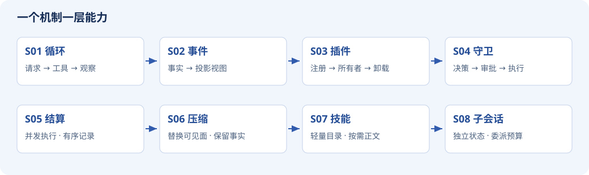

# Learn DeepSeek Harness

### 从一个循环，搭出智能体的运行环境

**[在线阅读完整教程 →](https://xinzhuwang-wxz.github.io/learn-deepseek-harness/)** · [从第一课开始](https://xinzhuwang-wxz.github.io/learn-deepseek-harness/s01-loop.html) · [Markdown 讲义](docs/00-start.md) · [运行代码](lessons/s01_loop/code.py)

点开“在线阅读”即可学习，无需安装、下载或自行部署。想亲手运行实验时，再使用下面的 Python 快速开始。


从 39 行循环开始，亲手搭建可回放、可卸载、有执行边界的智能体运行时。

八个累计阶段，每课增加一个核心机制。先观察失败，再实现修复，最后用测试与固定版本源码核对。每份 code.py 都可以单独运行，无模型下载、API key、GPU 或第三方 Python 包。

## 你会搭出什么

一个能把模型请求、工具调用和观察结果连起来的小运行时，再逐层加入事件历史、资源所有权、权限与审批、并发结算、上下文压缩、技能加载和子会话。

模型决定提出什么动作，运行时负责动作的执行条件、状态和结果。本课程用可重复的脚本模型隔离这些机制：研究的是运行时怎样工作，而不是用预设输出证明模型有多聪明。

[](https://xinzhuwang-wxz.github.io/learn-deepseek-harness/)

### 不只是读源码

- **看图理解机制**：所有权树、权限分支、并发时序与状态边界各用合适的图来讲。
- **在正文里读代码**：关键实现紧跟逐段解释，点击即可定位完整源文件。
- **用同一输入走一遍**：运行真实教学代码，追踪调用、事件和状态，不把动画当实测。
- **先看到失败，再修复**：修改并发声明、压缩切点或清理行为，观察不变量如何被破坏。

## 怎么学

会读基本 Python 即可开始；异步机制在对应章节解释。按 S01 → S08 推进，每课遵循“问题 → 图示 → 代码 → 走读 → 练习”。熟悉基础后，也可以直接进入[综合实验](docs/10-capstone.md)或[事件轨迹实验室](docs/11-traces.md)。

## 三分钟开始

需要 Python 3.10 或更新版本：

```sh
python3 lessons/s01_loop/code.py
python3 lessons/s04_guards/code.py
python3 -m unittest discover -s tests -v
python3 -m examples.scenarios
```

第一个实验得到 42；第二个因为缺少审批通道返回 DENIED。教学工具只操作内存，不执行 shell 或操作主机文件。

## 学习路线

| 阶段 | 核心问题 | 讲义 | 代码 |
|---|---|---|---|
| S01 | 工具结果怎样回到模型？ | [闭环](docs/02-loop.md) | [code.py](lessons/s01_loop/code.py) |
| S02 | 事实与视图为什么分开？ | [事件投影](docs/03-events.md) | [code.py](lessons/s02_events/code.py) |
| S03 | 插件卸载后谁负责清理？ | [注册所有权](docs/04-plugins.md) | [code.py](lessons/s03_plugins/code.py) |
| S04 | 谁决定工具能否执行？ | [决策管线](docs/05-guards.md) | [code.py](lessons/s04_guards/code.py) |
| S05 | 并发完成为什么仍要有序提交？ | [有序结算](docs/06-settlement.md) | [code.py](lessons/s05_settlement/code.py) |
| S06 | 压缩怎样保留工具协议？ | [安全边界](docs/07-compaction.md) | [code.py](lessons/s06_compaction/code.py) |
| S07 | 技能为什么先列目录再加载？ | [按需知识](docs/08-skills.md) | [code.py](lessons/s07_skills/code.py) |
| S08 | 子会话怎样隔离状态与预算？ | [有边界委派](docs/09-subagents.md) | [code.py](lessons/s08_subagents/code.py) |

[入门](docs/00-start.md) · [综合实验](docs/10-capstone.md) · [轨迹实验室](docs/11-traces.md) · [完整代码册](docs/13-codebook.md) · [源码到实验的方法](docs/01-method.md)

## 维护与本地预览

普通读者直接访问顶部在线教程。下面面向希望修改讲义、运行检查或自行托管的读者。

<details>
<summary>展开构建、发布与可选 PDF 说明</summary>

### 网页与 Markdown

讲义在 docs/ 中维护，可直接在 GitHub 阅读和编辑。安装 [Pandoc](https://pandoc.org/installing.html) 后构建网站：

```sh
make check
# 打开 site/index.html，或在本机预览：
python3 -m http.server 8000 --directory site
```

打开 http://localhost:8000。网站提供离线搜索、主题、学习进度、阶段差异和真实实验记录的逐事件查看器；每课可下载 Markdown 和代码。所有资源使用相对路径，无 CDN 或外部字体，支持 GitHub Pages 的项目子路径。

site/、output/ 和 dist/ 都是生成物，不提交到仓库。修改讲义、教学代码或配置后重新运行 make check；不要直接修改生成的 HTML。普通构建不会覆盖讲义或 code.py；练习修改造成片段/输出不一致时会明确报错。只有显式运行 make regenerate 才会重生成累计快照、相邻差异、代码册与轨迹讲义，该命令会覆盖相应文件，请先保存自己的练习。

### GitHub Pages 自动构建

工作流位于 [.github/workflows/pages.yml](.github/workflows/pages.yml)，使用核实并固定到 commit 的官方 GitHub Actions。仓库 Settings → Pages → Build and deployment 选择 GitHub Actions。推送到 main 后依次运行 Python 测试、源码核验、生成一致性检查、Pandoc 构建、链接及项目子路径检查，然后部署静态站点。Pull Request 只检查，不部署。详见 [发布与维护](PUBLISHING.md)。

不需要自建服务器、部署密钥、模型凭据或付费依赖。默认构建和发布不依赖 Chromium，也不生成或携带 PDF。需要个人阅读副本时，可在本地将 site/book.html 打印为 PDF；可选脚本见 [来源与重建](docs/12-sources.md)。

</details>

## 来源、许可与边界

- 上游：[deepseek-ai/deepseek-harness](https://github.com/deepseek-ai/deepseek-harness/tree/22ddee3792402c3e70ec5f86a63c3e3e895a2f60)，固定 commit 22ddee3792402c3e70ec5f86a63c3e3e895a2f60。
- [sources.json](sources.json) 给出 23 个精确源码锚点；[upstream.lock.json](upstream.lock.json) 记录基线；[QA_REPORT.md](QA_REPORT.md) 说明实际验证范围。
- [LICENSE](LICENSE) 覆盖课程代码和讲义。附带的 DeepSeek MIT 参考源码保留其[许可](legal/DeepSeek-Harness-MIT.txt)，仅供离线核对，不是运行依赖。

独立教学项目，非 DeepSeek 官方教程。教学实现不兼容官方 dsh，不是生产安全边界；上游处于 developer preview。本项目没有验证真实模型、操作系统沙箱、完整插件集成或生产性能。

