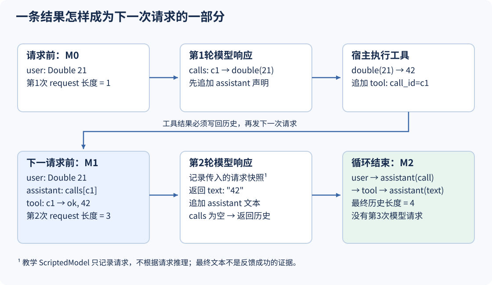
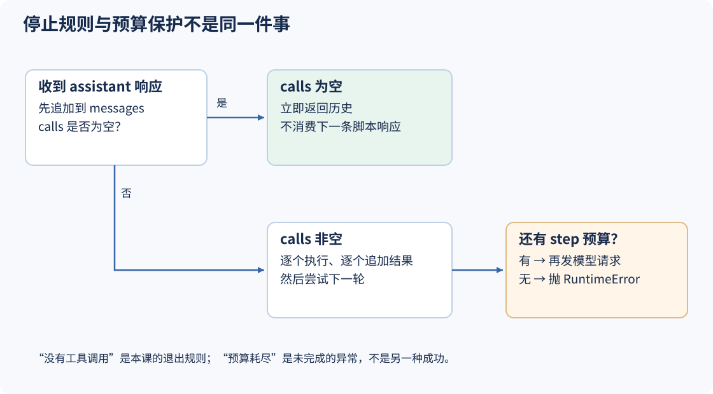

# S01 让工具结果回到下一次请求

一个聊天程序通常只做两件事：把用户问题交给模型，再把回答显示出来。但如果回答是“调用 double，参数 value=21”，显示这段文字并不会真的得到计算结果。即使宿主计算出了42，只把42画成一个气泡也不够：**下一次模型请求必须带上这条观察。**

本课用一个可以完全看清的例子搭起反馈循环。模型提出调用，宿主执行工具，把调用声明和结果写入历史，再发出下一次请求；当响应不再提出工具调用时结束。先不接真实模型，也不接网络或命令行工具。要验证的是数据有没有走完整条路径，不是模型会不会算乘法。

## 1. 先拆穿一个看起来成功的42

在项目根目录运行：

```sh
python3 walkthroughs/s01_loop.py blind
```

输出为：

```json
{
  "request_lengths": [1, 1],
  "second_request_saw_tool": false,
  "scripted_final": "42"
}
```

两次请求都只有最初的用户消息，第二次没有任何工具结果，最后却仍然得到42。实验没有执行工具，也没有运行完整循环，只连续调用了两次假模型。这不是反馈成功，而是测试替身给出了预先写好的答案。

先看这个假模型究竟做了什么：

[本课 code.py：记录请求，然后取下一条固定响应，第 5–12 行](../lessons/s01_loop/code.py#L5-L12)

<!-- snippet: lessons/s01_loop/code.py:5:12 -->
```python
class ScriptedModel:
    def __init__(self, responses):
        self.responses = iter(responses)
        self.requests = []

    def respond(self, messages):
        self.requests.append(json.loads(json.dumps(messages)))
        return next(self.responses, {"text": "script exhausted"})
```

`responses`是一个迭代器；每次`respond`先复制收到的messages，保存到`requests`，然后返回下一条预设响应。它既没有读取工具结果来计算答案，也没有推理、决定或检查任务是否成功。这里的JSON往返复制使早期请求不会因为messages之后继续追加而一起变长。

因此我们需要另一种判断标准：不只检查最后有没有“42”，而是检查**第二次实际请求中的最后一条消息是否是c1对应的工具结果**。这个标准会贯穿后面的课程。

## 2. 让一个调用、一个结果和一次请求对应起来

默认输入与工具表就在循环入口：

[本课 code.py：固定脚本、初始历史与纯内存工具，第 15–21 行](../lessons/s01_loop/code.py#L15-L21)

<!-- snippet: lessons/s01_loop/code.py:15:21 -->
```python
def run(responses=None, max_steps=4, model=None):
    model = model or ScriptedModel(responses if responses is not None else [
        {"calls": [{"id": "c1", "name": "double", "args": {"value": 21}}]},
        {"text": "42"},
    ])
    messages = [{"role": "user", "content": "Double 21"}]
    tools = {"double": lambda args: args["value"] * 2}
```

先认清三种不同的东西：

- `messages`是已经发生的对话。最初只有`user`的“Double 21”。
- 模型返回的`calls`是**待执行请求**，不是已经完成的事实。`name="double"`用于查找工具，`args`交给工具体。
- `id="c1"`给这一次调用命名。结果使用`call_id="c1"`配对，不能只用工具名：同一轮完全可以调用两次double。

工具表只允许名为double的本地函数，它把`args["value"]`乘以2。这些消息字段是本课自己的小协议，不是某个模型供应商的完整API结构。默认最终文本固定为“42”，后面的反例会再次利用这一点。



图中M0、M1、M2是历史在不同位置的状态标签，不是三个互相同步的数据库。程序只有一个不断追加的messages列表；假模型的requests保存每次收到它时的副本。

## 3. 循环的关键不是while，而是写入位置

外层循环先取得响应，再把响应写入历史：

[本课 code.py：先记录助手声明，再决定是否执行工具，第 22–28 行](../lessons/s01_loop/code.py#L22-L28)

<!-- snippet: lessons/s01_loop/code.py:22:28 -->
```python
    for _ in range(max_steps):
        response = model.respond(messages)
        messages.append({"role": "assistant", "content": response})
        calls = response.get("calls", [])
        if not calls:
            return messages
        for call in calls:
```

为什么不能直接跳到执行工具？因为后面的结果必须能回答“这是对哪条请求的回应”。先保留完整assistant响应，历史才有c1的声明；随后追加的`tool`消息才有可解释的归属。

`response.get("calls", [])`把缺少calls视为没有调用。没有调用立即return，连下一条脚本响应都不再消费。这里判断的是结构，不是自然语言内容；即便文本写着“我还没完成”，本课也会按无调用结束。更丰富的续跑规则要在这个最小闭环之外设计。

有调用时，宿主才进行查表和执行：

[本课 code.py：把成功或失败变成关联观察，第 29–35 行](../lessons/s01_loop/code.py#L29-L35)

<!-- snippet: lessons/s01_loop/code.py:29:35 -->
```python
            try:
                value = tools[call["name"]](call["args"])
                result = {"ok": True, "value": value}
            except (KeyError, TypeError, ValueError) as exc:
                result = {"ok": False, "error": type(exc).__name__}
            messages.append({"role": "tool", "call_id": call["id"], "content": result})
    raise RuntimeError("teaching step budget exhausted")
```

这段代码没有让模型直接执行Python。宿主读取工具名，从自己提供的字典中找到函数，再传入参数。正常返回得到`{"ok": True, "value": 42}`；指定的异常则变成结构化失败。无论这两种结果中的哪一种，都用同一个call_id追加到messages。

本例中的`KeyError`既可能来自找不到工具，也可能来自缺少参数；它不是精细的业务错误分类。代码只捕获`KeyError`、`TypeError`、`ValueError`，不吞掉所有异常，也不验证重复ID或完整调用格式。例如缺少调用ID的错误发生在追加结果时，不在这个try范围内。不要把这个小循环当成接收不可信工具协议的完整入口。

## 4. 跟着同一个输入走完两轮

```sh
python3 walkthroughs/s01_loop.py feedback
```

输出中的`request_lengths`为`[1, 3]`，`history_roles`为`["user", "assistant", "tool", "assistant"]`。第二次实际请求的末项为：

```json
{
  "role": "tool",
  "call_id": "c1",
  "content": {"ok": true, "value": 42}
}
```

这是从本课`ScriptedModel.requests`取出的记录，不是脚本另外拼出来的预期答案。走读脚本直接加载本课快照，并对比请求中的结果与返回历史：

[走读脚本：检查真实调用路径上的两处状态，第 17–26 行](../walkthroughs/s01_loop.py#L17-L26)

<!-- snippet: walkthroughs/s01_loop.py:17:26 -->
```python
def feedback_case(value=21, name='double'):
    model = h.ScriptedModel(script(value, name))
    messages = h.run(model=model)
    result = messages[2]
    assert model.requests[1][-1] == result
    assert len(model.requests) == 2
    if name == 'double':
        assert result['content'] == {'ok': True, 'value': value * 2}
    else:
        assert result['content'] == {'ok': False, 'error': 'KeyError'}
```

`h`指向`lessons/s01_loop/code.py`。这里`messages[2]`用于检查这个固定单调用案例，不是建议生产协议靠第三条消息配对；真正配对字段仍是call_id。

| 位置 | 此时发生什么 | messages中的角色 | 模型已经收到什么 |
|---|---|---|---|
| 初始 | 放入用户输入 | user | 尚未请求 |
| 第1次respond后 | 返回calls[c1]，追加声明 | user、assistant | 只有user |
| 工具返回后 | 追加c1→42 | user、assistant、tool | 第1次请求不会被回写改变 |
| 第2次respond时 | 发送完整的新历史 | user、assistant、tool | 用户、调用声明、结果都在 |
| 第2次respond后 | 文本响应没有calls，追加后返回 | user、assistant、tool、assistant | 不再发第3次请求 |

如果把工具结果只写到界面，不追加到messages，表中的第4行就缺少tool。最终仍可能出现42，但第1节的blind对照已证明那不能算反馈证据。正确修复是让结果进入下一请求的数据源，而不是把最终文本改成预期值。

### 失败也需要回灌

```sh
python3 walkthroughs/s01_loop.py missing
```

只有工具名改为missing。第二次请求的末项变为：

```json
{
  "role": "tool",
  "call_id": "c1",
  "content": {"ok": false, "error": "KeyError"}
}
```

循环没有把这次失败伪装成空字符串或成功的null，下一轮至少能区分“工具返回了值”和“没有找到可执行的工具”。但这个假模型最后依然输出固定42。这里同时成立两件事：**反馈管道正确地传回了失败；预设的最终回答没有根据失败作出调整。** 真实模型是否能据此修正，需要另外的模型评估，不能由本实验推出。

## 5. 停止与预算回答的是不同问题



先运行停止实验：

```sh
python3 walkthroughs/s01_loop.py stop
```

```json
{
  "requests": 1,
  "history_roles": ["user", "assistant"],
  "next_unconsumed_call": "c1"
}
```

脚本先放入`{"text": "done"}`，后面再放一条调用响应。run只发出一次请求。走读在run返回后从迭代器中取下一项，证实c1仍未被循环消费；这个检查动作不是额外的模型请求。

再运行预算实验：

```sh
python3 walkthroughs/s01_loop.py budget
```

```json
{
  "max_steps": 1,
  "requests": 1,
  "returned": false,
  "error": "teaching step budget exhausted"
}
```

这一轮已经走过调用处理，但需要下一次模型响应才能遇到“没有calls”的退出条件。预算只允许一轮，因此显式失败，不能把最后一个工具值当作完整任务结果返回。`max_steps`限制的是循环轮数，不是工具调用总数、费用或运行秒数；一轮中的多个调用仍会依次执行。

把预算改为2：

```sh
python3 walkthroughs/s01_loop.py budget --max-steps 2
```

现在得到`requests=2`、`returned=true`、`last_role="assistant"`。这只是固定脚本具备足够轮次，不证明任意任务两轮都能结束。本课假模型在响应耗尽后还会返回`script exhausted`文本；它同样会按无调用停止，所以有效实验应明确提供最终响应，不把“脚本用完”当作模型完成任务。

## 6. 练习：先预测请求，再看最终文本

以下命令只执行本地快照和内存工具，无需密钥。每项都包含断言。

| 要观察的问题 | 命令 | 实际应观察到什么 |
|---|---|---|
| 工具是否收到新参数 | `python3 walkthroughs/s01_loop.py feedback --value 7` | 第二请求中的value为14，但固定最终文本仍为42 |
| 失败是否也进入下轮 | `python3 walkthroughs/s01_loop.py missing` | c1对应ok=false、KeyError；请求长度仍为[1,3] |
| 已结束后会不会多跑一轮 | `python3 walkthroughs/s01_loop.py stop` | 只有1次request，后面的c1未消费 |
| 预算是否被冒充成功 | `python3 walkthroughs/s01_loop.py budget` | returned=false，明确预算错误 |

第一项中用户消息仍是固定的“Double 21”，只有预设调用参数变成7。这是故意隔离变量：我们检查宿主是否忠实执行调用参数，而不是声称模型正确理解了用户问题。

动手扩展：在`feedback_case`旁边新增一个案例，让同一条响应提出c1→double(21)与c2→double(3)，再接一个纯文本响应。先写出预期：第二次请求应该有4条消息，两个工具结果的call_id分别为c1、c2，value分别为42、6。复用`h.run(model=model)`，不要另写一个“看起来一样”的循环。

完成后可运行完整走读并对照[实际默认输出](../walkthroughs/expected/s01_loop.json)：

```sh
python3 walkthroughs/s01_loop.py all
python3 lessons/s01_loop/code.py
```

## 7. 沿着同一条反馈路径读DeepSeek源码

DeepSeek Harness的默认驱动器同样把模型请求、工具执行和已接受事实的提交连接起来，但它不只有本课这一个结束分支。

- [ReactLoopAgent的步骤驱动](https://github.com/deepseek-ai/deepseek-harness/blob/22ddee3792402c3e70ec5f86a63c3e3e895a2f60/packages/core/agent-loop/src/agent.ts#L428-L617)：沿`step`追踪请求准备、流式响应与工具调用。重点找历史在什么时候成为请求、事实在什么时候被提交，不要把流式文本片段直接等同于完整响应。
- [默认驱动器的公开约定](https://github.com/deepseek-ai/deepseek-harness/blob/22ddee3792402c3e70ec5f86a63c3e3e895a2f60/packages/core/agent-loop/README.md#L73-L84)：每一步发送派生历史和可见工具schema，完整调用批次交给`ctx.tools.execute()`，再由后续步骤使用已记录事实。

教学版没有真实模型适配器、流式输出、重试、inbox、审批或持久日志。“无调用就返回”只是最小退出规则，不是上游完整turn语义。

## 下一课：messages能回答所有问题吗？

现在我们知道c1的结果确实进入了下一次请求。但只看这四条消息，无法指出调用处理从哪一步开始、哪一步结束；如果其他组件拿到同一个嵌套字典，还可能修改已经记录的内容。S02将把“发生过的事实”与“给模型看的消息”分开，同时守住写入和读取两侧的数据边界。
