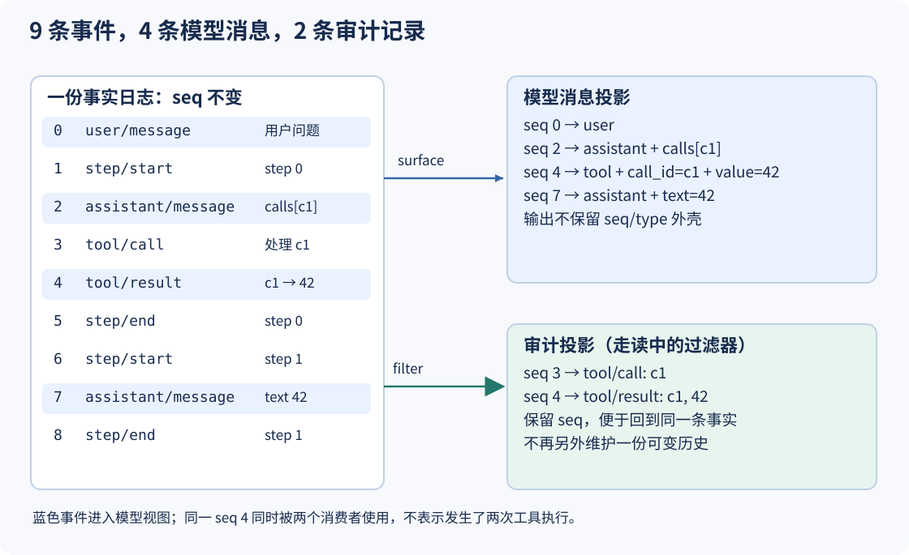
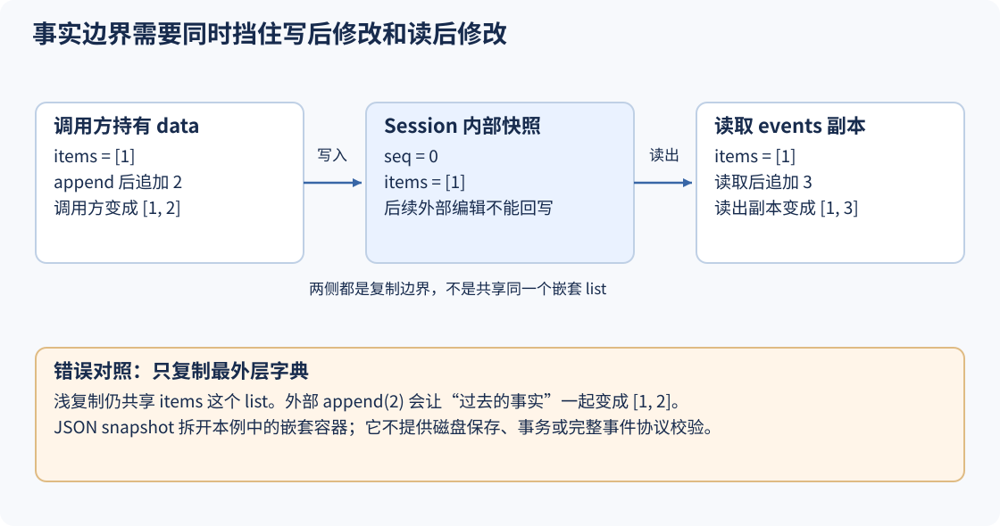

# S02 一份事件事实，多个读取视图

S01已经让double(21)的结果进入第二次模型请求。但messages承担了两种工作：既保存发生过什么，又决定模型下一次看什么。问题来了：调用处理从哪一轮开始、什么时候结束，这些信息值得记录，却未必应该全部塞进模型上下文。

如果为界面、审计和模型各维护一份历史，它们还可能逐渐分歧：界面显示工具已完成，模型却没有收到结果；审计记录了一次调用，聊天记录被另一段代码改掉了参数。

本课让Session拥有一份追加事件序列，再从这份事实导出不同视图。先强调范围：**这里的事件日志仍是内存列表，不保存到磁盘；重新构造Session也不是崩溃恢复。** 我们要先弄清事实、投影和可变对象的关系。

## 1. 同样算出42，为什么变成9条记录？

```sh
python3 walkthroughs/s02_events.py projection
```

仍然只有一个用户问题、一次工具调用和一次最终回答。输出却包含9条log记录、4条model_messages、2条audit记录。关键索引为：

```json
{
  "surface_seq": [0, 2, 4, 7],
  "audit_seq": [3, 4]
}
```

数字不是额外的调用次数，而是原始事件的seq。模型视图取0、2、4、7；审计视图取3、4。两边都使用seq=4的工具结果，不意味着工具执行了两次。



这里有三层概念，先不要混在一起：

- `events`返回日志事件，每条包含seq、type、data。
- `surface()`选出本课允许成为模型消息的事件，仍保留事件外壳和原始seq。
- `messages()`把surface映射成role与消息内容，去掉seq/type/data这层外壳。

图中的audit不是Session已经提供的另一个方法，而是走读脚本从`session.events`派生的过滤结果。任何一个消费者都不应该再反向修改原始事实。

## 2. 新机制插在每次“追加消息”的地方

S01在循环中直接追加messages。本课改为追加有类型的事件；需要请求模型时，再调用`session.messages()`：

[本课 code.py：循环开始、派生请求、记录调用声明，第 50–59 行](../lessons/s02_events/code.py#L50-L59)

<!-- snippet: lessons/s02_events/code.py:50:59 -->
```python
def run(script, session, max_steps=4):
    tools = {'double': lambda args: args['value'] * 2}
    model = ScriptedModel(script)
    for step in range(max_steps):
        session.append('step/start', step=step)
        response = model.respond(session.messages())
        session.append('assistant/message', **response)
        calls = response.get('calls', [])
        for call in calls:
            session.append('tool/call', call_id=call['id'], name=call['name'])
```

`step/start`在模型请求之前记录，但派生消息会过滤掉它。模型返回后追加`assistant/message`，其中包含原来的calls。每次处理调用又追加一条`tool/call`，让日志能够表达“宿主进入了这次调用处理”。

注意这两个事件并不重复：`assistant/message`是模型提出的调用声明；`tool/call`是宿主处理过程的标记。此时工具体还未返回，因此不能从tool/call推断成功，更不能把它当作可安全重试的证明。

随后沿用S01的本地工具与错误转换：

[本课 code.py：记录结果和step结束，再决定是否返回，第 60–67 行](../lessons/s02_events/code.py#L60-L67)

<!-- snippet: lessons/s02_events/code.py:60:67 -->
```python
            try:
                outcome = {'ok': True, 'value': tools[call['name']](call['args'])}
            except (KeyError, TypeError, ValueError) as exc:
                outcome = {'ok': False, 'error': type(exc).__name__}
            session.append('tool/result', call_id=call['id'], **outcome)
        session.append('step/end', step=step)
        if not calls: return session.messages()
    raise RuntimeError('script ended without final response')
```

正常结果或指定异常被写成`tool/result`。这一轮的`step/end`发生在结果之后。下一轮重新派生messages，刚才的结果就能进入请求；没有调用的最终一轮也会记录start与end，而不只是留下文本。

本课的`run`内部创建ScriptedModel，并没有把内部模型实例返回。下面的走读直接检查Session的真实事件及派生消息，不将事后投影冒称为抓取到的内部request；实际请求由第55行明确调用这同一个`session.messages()`产生。S01已经单独检查过实际request的反馈关系。

## 3. 用seq把一次运行逐条展开

`seq`不是模型轮数，不是时间戳，也不是工具ID。它只是**当前Session中这条事件的追加位置**，从0连续增长。c1可以出现在多个不同seq中，因为同一个调用会经历声明、处理、结果等不同事实。

| seq | type | 这条记录表达什么 | 是否进入本课模型视图 |
|---:|---|---|---|
| 0 | user/message | 用户提出Double 21 | 是，user |
| 1 | step/start | 第0轮开始 | 否 |
| 2 | assistant/message | 模型提出calls[c1] | 是，assistant |
| 3 | tool/call | 宿主开始处理c1 | 否 |
| 4 | tool/result | c1得到ok=true、value=42 | 是，tool |
| 5 | step/end | 第0轮结束 | 否 |
| 6 | step/start | 第1轮开始 | 否 |
| 7 | assistant/message | 模型返回文本42 | 是，assistant |
| 8 | step/end | 第1轮结束 | 否 |

第一次请求时，日志已经有seq 0和1，messages只产生用户消息。第二次请求时，日志已有seq 0至6，messages产生用户、调用声明和工具结果三条。运行结束后查询messages才有第四条最终回答。**最终视图的4条消息，不等于每次请求都包含4条。**

分配seq与写入事实集中在一个入口：

[本课 code.py：追加事件时分配位置，第 39–42 行](../lessons/s02_events/code.py#L39-L42)

<!-- snippet: lessons/s02_events/code.py:39:42 -->
```python
    def append(self, kind, **data):
        event = snapshot({'seq': len(self._events), 'type': kind, 'data': data})
        self._events.append(event)
        return event['seq']
```

对空Session第一次append，`len(self._events)`为0，函数也返回0。数据先经过snapshot，再追加到内部列表；如果快照失败，就不会占用一个新seq。单一入口让有效运行的追加顺序清楚可查，但本课没有并发写入控制、跨进程序号或事务保证。

派生视图只有两小段：

[本课 code.py：筛选可见事件，再映射模型角色，第 44–48 行](../lessons/s02_events/code.py#L44-L48)

<!-- snippet: lessons/s02_events/code.py:44:48 -->
```python
    def surface(self):
        return snapshot([e for e in self._events if e['type'] in {'user/message', 'assistant/message', 'tool/result'}])

    def messages(self):
        return [{'role': {'user/message': 'user', 'assistant/message': 'assistant', 'tool/result': 'tool'}[event['type']], **event['data']} for event in self.surface()]
```

`surface`保留user/message、assistant/message、tool/result，顺序仍和日志一致。`messages`将事件种类映射为role，并把data字段展开，所以结果变成`{"role": "tool", "call_id": "c1", "ok": True, "value": 42}`。这里与S01的`content`嵌套格式不同，变化的是教学消息结构，不是call_id的配对职责。

若把所有events原样发送给模型，step边界、seq和data外壳会和对话协议混在一起；若只留下气泡文本，又会丢掉控制事实。正确做法不是二选一，而是保留原始事件，让每个消费者明确选择自己需要的部分。

## 4. 复制必须发生在写入和读出两侧

即使所有组件都通过append写日志，仍可能有隐藏的改写通道。比如调用方把`{"items": [1]}`交给Session，之后又对原列表追加2。如果Session保存的是同一个list，已经发生过的事实就悄悄变成了`[1,2]`。

本课用JSON往返创建独立的数据树：

[本课 code.py：为JSON兼容数据创建快照，第 11–13 行](../lessons/s02_events/code.py#L11-L13)

<!-- snippet: lessons/s02_events/code.py:11:13 -->
```python
def snapshot(value: Any) -> Any:
    """Create a JSON-normalized copy; reject non-finite or unsupported values."""
    return json.loads(json.dumps(value, allow_nan=False))
```

这里适用的输入是本教程使用的JSON兼容结构。`allow_nan=False`拒绝NaN和Infinity；set、函数等不可序列化对象也会失败。它不是任意Python对象的保真复制器：例如tuple会变成list，某些非字符串字典键也会在JSON转换中改变表示，不能把这种规范化误认为完整schema验证。

读出也要复制，否则拿到events的人可以绕过append直接改历史：

[本课 code.py：读者拿到的是副本，第 35–37 行](../lessons/s02_events/code.py#L35-L37)

<!-- snippet: lessons/s02_events/code.py:35:37 -->
```python
    @property
    def events(self):
        return snapshot(self._events)
```



运行同一个带嵌套list的实验：

```sh
python3 walkthroughs/s02_events.py snapshot
```

```json
{
  "assigned_seq": 0,
  "unsafe_alias_items": [1, 2],
  "after_input_edit": [1],
  "edited_read_items": [1, 3],
  "edited_message_items": [1, 4],
  "stored_items": [1],
  "stored_event_count": 1
}
```

`unsafe_alias_items`来自故意保留输入引用的错误方案，它被调用方的append(2)污染。实际Session同时抵挡了三次外部修改：原输入增加2、events副本增加3、messages副本增加4。往events副本末尾塞一个伪造事件，也没有让内部条数从1变成2。

关键动作并不藏在测试框架里：

[走读脚本：分别修改输入、事件副本和消息副本，第 32–42 行](../walkthroughs/s02_events.py#L32-L42)

<!-- snippet: walkthroughs/s02_events.py:32:42 -->
```python
    data = {'items': [1]}
    unsafe = [{'type': 'user/message', 'data': data}]
    session = h.Session()
    assigned = session.append('user/message', **data)
    data['items'].append(2)
    after_input_edit = session.events[0]['data']['items']
    read = session.events
    read[0]['data']['items'].append(3)
    read.append({'seq': 1, 'type': 'forged', 'data': {}})
    message_view = session.messages()
    message_view[0]['items'].append(4)
```

`**data`只展开最外层键值，并不会自动深复制items。保护来自Session在append与读取路径上的snapshot，而不是函数调用语法。如果你仅用`dict(data)`复制外层字典，这个嵌套list仍会共享，实验同样会失败。

## 5. 重建能检查顺序，不能替代持久化

Session也可以从已有事件构造；入口先复制数据，然后检查seq与列表位置一致：

[本课 code.py：从事件前缀重建时检查连续序号，第 30–33 行](../lessons/s02_events/code.py#L30-L33)

<!-- snippet: lessons/s02_events/code.py:30:33 -->
```python
    def __init__(self, events=None):
        self._events = snapshot(events or [])
        if any((event['seq'] != i for i, event in enumerate(self._events))):
            raise ValueError('event sequence must be contiguous from zero')
```

运行：

```sh
python3 walkthroughs/s02_events.py replay
```

```json
{
  "same_messages_before_append": true,
  "original_events": 9,
  "replay_events": 10,
  "replay_first_text": "Double 21",
  "replay_last_seq": 9
}
```

走读先把`original.events`交给新的Session，确认两者派生消息相等，再修改导出的数据并向新Session追加一条用户消息。原Session仍有9条事件，新Session有10条；新Session的第一条文本也没有被外部编辑污染。

这里的“重建”只是把同一进程里的JSON数据复制到另一个对象，既没有从磁盘读取，也没有重新执行double。事件重放和工具重试是不同的动作；缺少结果不能自动成为重试理由。

再故意把索引4处的seq改为99：

```sh
python3 walkthroughs/s02_events.py corrupt
```

结果是`ValueError: event sequence must be contiguous from zero`，而不是自动重排或悄悄修复。顺序异常应先暴露，否则后面的投影可能在不可靠的输入上继续工作。

这项检查仍然很窄：它比较seq和枚举位置，不验证所有事件字段、调用/结果配对或业务内容，也不证明一份日志没有丢掉末尾。它甚至不是严格的整数类型校验器，Python中某些数值相等性会通过这个比较。我们只在已约定的事件结构上用它发现序号断裂，不把它称为完整日志完整性校验。

## 6. 练习：让两个读者共享事实，不共享可变对象

先运行这些已有实验，检查预测是否成立：

| 实验 | 命令 | 应观察到的结果 |
|---|---|---|
| 去掉模型不需要的生命周期事件 | `python3 walkthroughs/s02_events.py projection` | surface_seq=[0,2,4,7]，没有step事件 |
| 输入和读出都被外部编辑 | `python3 walkthroughs/s02_events.py snapshot` | stored_items仍为[1]，内部事件仍为1条 |
| 用相同事实重建视图 | `python3 walkthroughs/s02_events.py replay` | 追加前messages相等，追加后原9条、新10条 |
| 拒绝非有限数与不可序列化对象 | `python3 walkthroughs/s02_events.py json` | nan→ValueError，set→TypeError |

动手完成一个审计视图：在走读文件里新增`audit_view(session)`，只返回tool/call和tool/result，并保留seq。可以先参考现有过滤器：

[走读脚本：从同一事件源派生审计视图，第 18–25 行](../walkthroughs/s02_events.py#L18-L25)

<!-- snippet: walkthroughs/s02_events.py:18:25 -->
```python
def projection_case():
    session = filled_session()
    events, surface, messages = session.events, session.surface(), session.messages()
    audit = [e for e in events if e['type'] in {'tool/call', 'tool/result'}]
    assert len(events) == 9 and len(messages) == 4
    assert [e['seq'] for e in surface] == [0, 2, 4, 7]
    assert [e['seq'] for e in audit] == [3, 4]
    assert messages[2] == {'role': 'tool', 'call_id': 'c1', 'ok': True, 'value': 42}
```

完成后应得到seq `[3,4]`，工具结果仍是42。然后把返回的审计结果中的value改成999，再次调用`session.messages()`：工具值应该仍为42。这个练习不需要新增一份审计数据库，更不需要从最终文本“42”反向推断执行过程。

进阶思考：如果增加一种仅供界面显示的`ui/progress`事件，原始日志应该增长，模型messages应该不变。应修改投影的选择规则还是修改所有消费者？先写出你希望哪一层拥有这项决定。

完整默认输出可与[实际记录](../walkthroughs/expected/s02_events.json)对照：

```sh
python3 walkthroughs/s02_events.py all
python3 lessons/s02_events/code.py
```

## 7. 回到DeepSeek：surface不只是“过滤一下”

[DeepSeek Session的deriveMessages](https://github.com/deepseek-ai/deepseek-harness/blob/22ddee3792402c3e70ec5f86a63c3e3e895a2f60/packages/core/session/src/index.ts#L999-L1024)从当前surface的节点读取原始日志，再派生模型消息；它还使用generation管理派生缓存。本课用三种事件类型的简单筛选表达最初的边界，不能把它当作上游surface全部语义。S06会进一步加入“日志保留、可见视图替换”。

[上游架构中的事件域](https://github.com/deepseek-ai/deepseek-harness/blob/22ddee3792402c3e70ec5f86a63c3e3e895a2f60/docs/architecture.zh.md#L7-L173)还区分session事实、实时Agent观察和能力扩展事件。并不是所有UI进度或流式片段都自动成为可重放事实，也不是每一条持久事实都必须逐字进入模型上下文。

本课没有磁盘耐久性、写入事务、损坏文件恢复、完整协议校验或多进程一致性。它先建立一条可以检查的数据流：**追加事实 → 选择视图 → 形成消息**。

## 下一课：记录清楚了，谁负责把工具收回？

事件能说明double被调用过，却不能决定一个临时插件结束后double还该不该存在。S01、S02的工具字典始终在循环内部，无法表达“属于这个任务、只对子级可见、结束时撤销”。S03将给每次注册一个所有者，并让撤销只删除它自己创建的那一项。
