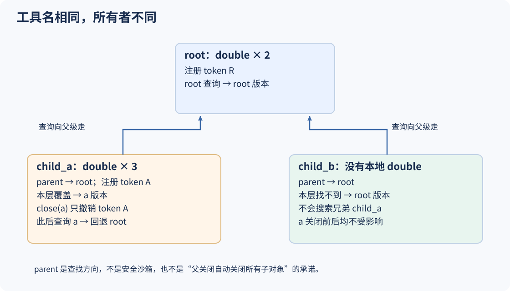
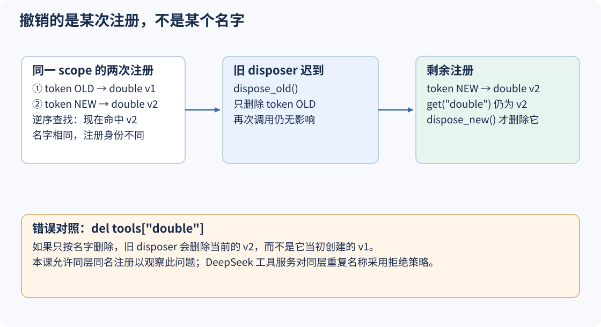

# S03 让每次工具注册都有主人

前两课的double住在循环内部的字典里：只要循环存在，它就一直可用。现在要加入一个临时任务，它注册自己的工具版本；任务结束后，这一项应该撤销，同时不能影响其他任务。

直接使用全局`tools["double"]`会遇到两个问题。第一，子任务覆盖同名工具后，兄弟任务也可能读到它的版本。第二，旧任务稍后清理时，如果只按名字删除，会把后来注册的新版本一起删掉。这不是模型选错工具，而是宿主没有表达**可见范围、注册身份和资源归属**。

本课加入Scope与Registry。Scope说明注册属于谁，并保管撤销函数；Registry按作用域查找工具，并按每次注册的独立token撤销。Session与模型反馈路径保留。这里的“插件”只聚焦注册与释放，不包含插件加载器、依赖注入或操作系统隔离。

## 1. 先给工具画出归属，而不是放进一个全局桶

构造root和两个兄弟作用域child_a、child_b。root注册double，child_a也注册同名工具，child_b不注册。为了从结果中分清提供方，实验把root版本设为乘2，a版本故意设为乘3；这只是观察同名覆盖，不表示乘3也满足“double”的业务约定。



从项目根目录运行：

```sh
python3 walkthroughs/s03_plugins.py ownership
```

关键输出为：

```json
{
  "before_close": {"root": "root", "child_a": "a", "child_b": "root"},
  "after_child_a_close": {"root": "root", "child_a": "root", "child_b": "root"},
  "child_a_closed": true,
  "remaining_entries": 1
}
```

before与after不是手写的可见性矩阵，而是分别调用`Registry.get`，再按返回的Tool对象身份标注其提供方。关闭a后，root版本没有被删除，兄弟b也从未见过a的覆盖。

尤其注意：`child_a_closed=true`时，查询a仍能回退到root。本课closed控制“还能否拥有新资源”，并不让get立即返回None。这个细节在讨论权限时很重要：**关闭注册所有者，不等于禁止它访问一切父级能力。**

## 2. Scope先解决“谁负责撤销”，Registry再解决“撤销哪一项”

Scope保存父级、清理函数列表和关闭状态：

[本课 code.py：声明资源所有者与注册入口，第 50–59 行](../lessons/s03_plugins/code.py#L50-L59)

<!-- snippet: lessons/s03_plugins/code.py:50:59 -->
```python
@dataclass(eq=False)
class Scope:
    parent: Scope | None = None
    disposers: list[Callable] = field(default_factory=list)
    closed: bool = False

    def owns(self, dispose):
        if self.closed:
            raise RuntimeError("scope already disposed")
        self.disposers.append(dispose)
```

`owns(dispose)`把一个无参数同步函数交给Scope保管。它不执行函数，只约定关闭时调用。关闭后的Scope拒绝继续登记资源，这样“任务已经结束却悄悄注册了新工具”的路径会立即暴露。

Registry把这个所有权机制接到一次具体注册上：

[本课 code.py：每次注册生成独立身份，并返回精确撤销函数，第 87–95 行](../lessons/s03_plugins/code.py#L87-L95)

<!-- snippet: lessons/s03_plugins/code.py:87:95 -->
```python
    def register(self, scope, tool):
        token = object()
        entry = (token, scope, tool)
        scope.owns(lambda: self._remove(token))
        self.entries.append(entry)
        return lambda: self._remove(token)

    def _remove(self, token):
        self.entries[:] = [e for e in self.entries if e[0] is not token]
```

沿着这9行追踪一个条目：

1. `object()`创建一个独立token，即使name相同，token也不同。
2. `entry`保存token、owner scope和Tool对象。
3. `scope.owns(...)`先登记一个捕获该token的撤销函数。
4. 只有登记成功，条目才进入entries。
5. 返回另一个针对相同token的函数，调用方也可以提前手动撤销。

两个lambda捕获同一个token，所以手动撤销之后Scope再次清理也是安全的：`_remove`只保留身份不匹配的条目；匹配项已经不存在时，再删一次只是没有变化。它不是“按工具名找一个差不多的东西删掉”。

为什么先owns再append？关闭的Scope会在owns抛错，entries还没有增加，不会留下“注册已经可见，但没有主人负责清理”的半成品。稍后的lifecycle实验会检查拒绝后entries仍为0。

## 3. 查找顺序有两层：先作用域，再注册新旧

`parent`规定向上查找的路径：

[本课 code.py：从当前作用域逐层走向父级，第 70–74 行](../lessons/s03_plugins/code.py#L70-L74)

<!-- snippet: lessons/s03_plugins/code.py:70:74 -->
```python
    def ancestors(self):
        cursor = self
        while cursor is not None:
            yield cursor
            cursor = cursor.parent
```

从child_a出发依次得到child_a、root；不会得到child_b。父级关系是构造好的普通Python对象引用，本课假定没有环，不提供自动环检测。

Registry在每一层内从后向前检查条目：

[本课 code.py：按所有者身份与工具名称匹配，第 97–102 行](../lessons/s03_plugins/code.py#L97-L102)

<!-- snippet: lessons/s03_plugins/code.py:97:102 -->
```python
    def get(self, name, scope):
        for layer in scope.ancestors():
            for _, owner, tool in reversed(self.entries):
                if owner is layer and tool.name == name:
                    return tool
        return None
```

外层循环优先选作用域，内层循环才按注册新旧排序。于是有两条不同规则：

- 当前层有同名工具，就不会再向父级找。即使root的工具更晚注册，当前层仍优先。
- 同一层允许多个同名条目，本课选择最近注册的一项；撤销它之后，较早的一项还可能重新可见。

`owner is layer`按对象身份判断所有者，不是比较名字。没有搜索兄弟作用域的分支，所以a的注册不会泄漏到b。所有层都找不到才返回None。

跟着ownership实验走一遍状态变化：

| 操作 | entries中的所有者 | 查询a时检查的路径 | 查询b的结果 |
|---|---|---|---|
| 注册root版本 | root | a没有 → root命中 | root |
| 注册a版本 | root、a | a直接命中，不再向上 | root |
| 关闭a | root | a没有 → root命中 | root |
| 再关闭a | root | 不再重复清理，查询不变 | root |

最后一行是幂等关闭的效果，不表示Scope被重新激活。想给一个新任务注册工具，应创建新的Scope，而不是往已关闭对象中继续塞资源。

## 4. 旧disposer迟到时，为什么不能按名字删除？

这是只用字典最容易遗漏的故障。旧插件注册double v1，新插件随后注册double v2。v1的清理函数晚一步执行，如果做的是`pop("double")`，删掉的会是当前v2。



先预测，再运行：

```sh
python3 walkthroughs/s03_plugins.py stale
```

```json
{
  "before": "new",
  "after_old_once": "new",
  "after_old_twice": "new",
  "remaining_before_new_dispose": 1,
  "after_new_dispose": null,
  "naive_name_delete_lost_new": true
}
```

实际Registry在旧撤销执行一次、两次后都还返回new。只有调用new自己的disposer才变成None。输出末项来自一份故意用名字删除的普通字典，证明错误方案确实丢了新项，而不是把错误结论直接写进结果。

走读中的核心动作如下：

[走读脚本：让旧撤销在新注册之后执行两次，第 41–48 行](../walkthroughs/s03_plugins.py#L41-L48)

<!-- snippet: walkthroughs/s03_plugins.py:41:48 -->
```python
    dispose_old = registry.register(scope, labels['old'])
    dispose_new = registry.register(scope, labels['new'])
    before = provider(registry, scope, labels)
    dispose_old()
    after_once = provider(registry, scope, labels)
    dispose_old()
    after_twice = provider(registry, scope, labels)
    remaining = len(registry.entries)
```

这里撤销函数不是“当前这个名字的删除权限”，而是“当初那一次注册的收据”。token不需要让用户阅读，不需要序列化，也不是认证密钥；它只在当前进程中表达不可混淆的注册身份。

还要把教学语义和上游分开：本课故意允许**同层同名**注册来显露旧撤销问题。DeepSeek工具服务对同层重复工具名采用拒绝策略。相同的是“撤销必须精确”，不是“两个注册系统的覆盖规则完全相同”。

## 5. 释放资源为什么常按逆序？

假设先创建连接，再建立依赖该连接的订阅。如果先关连接，订阅的清理函数可能已经无法完成收尾。Scope因此按后进先出执行清理：

[本课 code.py：关闭态、逆序释放与幂等入口，第 61–68 行](../lessons/s03_plugins/code.py#L61-L68)

<!-- snippet: lessons/s03_plugins/code.py:61:68 -->
```python
    def close(self):
        if self.closed:
            return
        self.closed = True
        # Resource-specific async teardown is deliberately outside this lesson.
        for dispose in reversed(self.disposers):
            dispose()
        self.disposers.clear()
```

第一次close先设置closed，再逆序调用disposers，最后清空列表。先设closed也能让清理期间的再次close直接返回，并阻止清理函数追加新的资源。

运行这个只有字符串标记、不创建真实连接的例子：

```sh
python3 walkthroughs/s03_plugins.py lifecycle
```

```json
{
  "cleanup_order": ["subscription", "connection"],
  "disposers_after_close": 0,
  "late_registration_error": "scope already disposed",
  "entries_after_rejection": 0
}
```

脚本先owns(connection)、再owns(subscription)，连续关闭两次，只观察到一次逆序清理。之后试图注册新工具会被拒绝，Registry仍为空。

不要把这个简单close扩大为所有资源都一定清理成功的保证：本课disposer是同步函数，没有等待异步任务；某个disposer抛异常会打断后续清理，且closed已为True，第二次close不会重新尝试。真实资源管理还要决定如何等待活动任务、聚合清理错误和重试失败项，这些不在当前实现中。

### 父子关系也不自动意味着级联释放

```sh
python3 walkthroughs/s03_plugins.py noncascade
```

```json
{
  "root_closed": true,
  "child_closed": false,
  "child_provider": "child",
  "remaining_entries": 1
}
```

root.close只调用root自己的disposers，没有保存或遍历child列表。child的本地注册仍然存在，仍需显式关闭child。图中的树首先是**查找继承树**，不能仅凭一个parent指针推导出资源关闭树。

如果应用确实需要级联，可以让父Scope显式拥有`child.close`这个清理动作，并认真决定注册顺序；本课默认没有这样绑定。它也不是OS安全边界：所有对象都在同一个Python进程中，能访问Registry的代码可以传入另一个Scope查询，恶意代码不会被这种普通对象关系隔离。

## 6. 把注册表插回原来的模型反馈循环

前面的实验主要读写Registry。现在要确认它真的决定工具体，而不是只在图上有作用。本课把工具分发改成`registry.get(name, scope)`：

[本课 code.py：按当前作用域查找并执行工具，第 108–118 行](../lessons/s03_plugins/code.py#L108-L118)

<!-- snippet: lessons/s03_plugins/code.py:108:118 -->
```python
async def run_batch(calls, registry, scope, session, policy=None, token=None, limit=1):
    results = []
    for call in calls:
        tool = registry.get(call['name'], scope)
        session.append('tool/call', call_id=call['id'], name=call['name'])
        try:
            if tool is None: raise ValueError('unknown tool')
            value = await tool.body(call['args'], CancelToken())
            outcome = {'ok': True, 'value': value}
        except Exception as exc:
            outcome = {'ok': False, 'error': type(exc).__name__}
```

`run_batch`逐个处理调用。找到Tool后await它的body；没有找到则抛出ValueError，并由同一个异常分支转成失败。工具体改成async函数，为后续异步调度留接口，但这个for循环仍然串行。

结果继续进入S02已经建立的事件通路：

[本课 code.py：调用身份随结果进入Session，第 119–121 行](../lessons/s03_plugins/code.py#L119-L121)

<!-- snippet: lessons/s03_plugins/code.py:119:121 -->
```python
        session.append('tool/result', call_id=call['id'], **outcome)
        results.append(outcome)
    return results
```

模型仍然声明c1，宿主仍然记录tool/call与tool/result，下一请求仍从Session派生消息。新增的是“根据哪个Scope取得哪个Tool”，没有改写调用/结果协议。

```sh
python3 walkthroughs/s03_plugins.py execution
```

这次在child作用域运行同一个double(21)调用，实际第二请求的末项为：

```json
{
  "role": "tool",
  "call_id": "c1",
  "ok": true,
  "value": {"provider": "child", "value": 63}
}
```

工具体确实执行了child注册的乘3版本，而不是root的乘2版本；value里的provider来自工具实际返回，call_id仍是模型提出的c1。这证明的是**作用域参与了分发**，不证明乘3满足用户任务。可见性与业务正确性是两个问题。

走读直接把可观察的模型实例传给本课agent_loop，再读取requests：

[走读脚本：从下一请求核对实际提供方与结果，第 101–108 行](../walkthroughs/s03_plugins.py#L101-L108)

<!-- snippet: walkthroughs/s03_plugins.py:101:108 -->
```python
    model = h.ScriptedModel([
        {'calls': [{'id': 'c1', 'name': 'double', 'args': {'value': 21}}]},
        {'text': 'done'},
    ])
    await h.agent_loop(model, registry, child, session)
    actual = model.requests[1][-1]
    assert actual['value'] == {'provider': 'child', 'value': 63}
    assert actual['call_id'] == 'c1'
```

这个实验依然使用固定响应模型，最后的done没有推理意义。真正的证据是第二次实际请求里出现了`provider=child`和63，而不是给结论起一个叫done的名字。

### 看得见，不代表已经批准或校验过

Tool结构里已经有validate和parallel字段，但S03的run_batch没有调用它们。参数里的policy、token、limit也尚未形成后面课程的权限、取消和并发语义。尤其不能因为看到了一个validator函数，就断言不合法参数已被阻止。

```sh
python3 walkthroughs/s03_plugins.py unchecked
```

```json
{
  "validator_would_return": false,
  "body_inputs": [21],
  "outcomes": [{"ok": true, "value": 42}]
}
```

走读注册了一个始终返回False的validator，但工具体仍记录输入21并返回42。输出中的validator_would_return由走读在执行后单独调用校验函数得到，不是run_batch执行过校验的证据。这不是让你绕过校验，而是用实际状态标出当前系统的缺口：**注册表只回答“能找到谁”，尚未回答“这次能否执行”。** 下一课就会在这条路径上插入检查，而不是靠模型自觉避开不合法调用。

## 7. 动手验证三个容易混淆的关系

| 关系 | 命令 | 应观察到的结果 |
|---|---|---|
| 子级覆盖与兄弟可见性 | `python3 walkthroughs/s03_plugins.py ownership` | a命中a，b命中root；关a后两者都回root |
| 注册名称与注册身份 | `python3 walkthroughs/s03_plugins.py stale` | 旧撤销两次都不删new，新撤销才删new |
| 创建顺序与清理顺序 | `python3 walkthroughs/s03_plugins.py lifecycle` | subscription先清理，connection后清理，重复close无新记录 |
| 父级可见与父级关闭 | `python3 walkthroughs/s03_plugins.py noncascade` | root关闭后child仍开放且本地工具仍在 |
| 声明validator与实际执行检查 | `python3 walkthroughs/s03_plugins.py unchecked` | body仍进入，说明还没有检查链 |

动手扩展一：在`ownership_case`中增加grandchild，其parent为child_a。预测关闭a之前grandchild返回a版本，关闭a之后返回root版本；再用`provider`读取真实结果验证。parent链延长了，但兄弟b的结果不应改变。

动手扩展二：复制`stale_case`写一个新案例，先撤销new，再查询。预期应重新看见old，因为本课允许同层多项，旧条目尚未删除。随后撤销old才得到None。与原实验的“先撤旧项”对照，说明你是否真的理解“删除条目”和“把名字设成空”不同。

完整走读带3秒异步超时；若自行修改工具后造成协程互相等待，会给出超时提示而不是无限挂起。这个保护只作用于会让出执行权的异步等待，不能中断阻塞解释器的死循环或同步函数。默认案例全部是本地、确定性的内存操作。

```sh
python3 walkthroughs/s03_plugins.py all
python3 lessons/s03_plugins/code.py
```

第一条可对照[实际默认输出](../walkthroughs/expected/s03_plugins.json)。第二条是本课累计系统的小示例，`visible_before=true`、`removed_after_dispose=true`；它检查可独立启动，前面的实验负责把覆盖、身份和清理边界分别解释清楚。

## 8. 回到DeepSeek的生命周期与注册服务

按职责阅读，不要把这里的三个Python类当作Cordis兼容接口：

- [Cordis的核心概念与可逆注册](https://github.com/deepseek-ai/deepseek-harness/blob/22ddee3792402c3e70ec5f86a63c3e3e895a2f60/docs/cordis-primer.zh.md#L7-L51)：服务从上下文取得，注册通过effect等机制进入生命周期，每项资源需要对应的disposer。
- [DeepSeek createScope与作用域路由](https://github.com/deepseek-ai/deepseek-harness/blob/22ddee3792402c3e70ec5f86a63c3e3e895a2f60/packages/core/scope/src/index.ts#L137-L171)：作用域关联Cordis fiber，dispose使用等待静止的异步边界；这里还能看到作用域对事件路由的影响。教学版同步close不具有这些保证。
- [工具服务的注册契约](https://github.com/deepseek-ai/deepseek-harness/blob/22ddee3792402c3e70ec5f86a63c3e3e895a2f60/packages/core/tools/src/index.ts#L99-L218)：工具注册返回精确disposer；作用域工具可以遮蔽全局工具，但同层重复名称与保留名称会被拒绝。上游还检查工具输出描述等条件，不是一张任意函数表。

教学版省略依赖激活、重载、异步卸载、活动任务静止和安全隔离。可见范围也不等于授权范围；继承到一个工具，仅意味着查找能够返回它。

## 下一课：在工具体之前补上执行决定

现在每次注册知道自己属于谁，旧撤销不会误删新项，但`unchecked`已经展示了一个更严重的空位：即使validator返回False，工具体仍然执行。S04会在进入body之前加入权限、审批和守卫，并检查拒绝路径的工具体执行次数必须为0。这样才能从“找到一个工具”走到“有依据地执行这一次调用”。
