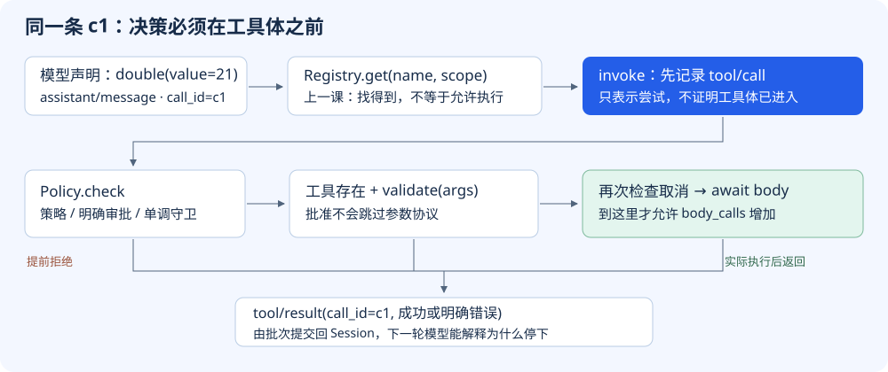
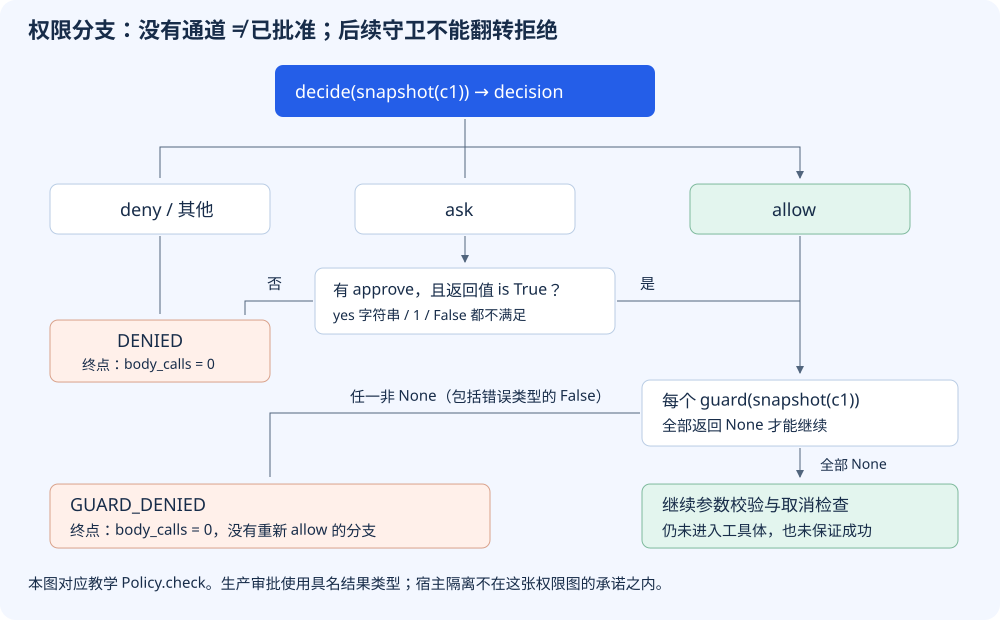

# S04 让拒绝发生在工具体之前

上一课解决了“哪个作用域能找到哪个工具”。但找到工具，不等于允许执行它。即便提示词写了“执行前请询问”，模型仍可能直接提出调用；如果宿主看到工具名就运行，提示词并没有挡在执行路径上。

本课仍使用一个纯内存的 `double(21)`，不引入真实文件或命令。我们把同一个调用放进不同决策分支，检查的不只是错误码，而是**工具体到底有没有进入**。工具不危险，也一样能检验审批缺失时是否关闭执行入口。

## 先看两次运行：同一输入，工具体进入次数不同

在项目根目录运行：

```sh
python3 walkthroughs/s04_guards.py unguarded
python3 walkthroughs/s04_guards.py missing
```

两次输入都是 `c1 → double → {"value": 21}`。第一条是故意绕过管线的反例，直接调用工具体；第二条走本课真正的 `run_batch`，策略要求审批，却没有审批通道。

| 实际运行 | 决策轨迹 `trace` | 工具体次数 | 结果 |
|---|---|---:|---|
| `unguarded` | `["body"]` | 1 | `ok: true, value: 42` |
| `missing` | `["decide"]` | 0 | `ok: false, code: "DENIED"` |

这不是模型服不服从的对比，而是**宿主有没有把执行决策接入必经路径**的对比。反例没有伪造审批成功，也不属于正常Agent运行；它明确展示绕过管线会失去什么。

工具体的计数器如下。`args`是本次工具参数，`token`留给取消检查使用，本例不修改它。

[走读脚本：计数真实工具体入口，第 14–18 行](../walkthroughs/s04_guards.py#L14-L18)

<!-- snippet: walkthroughs/s04_guards.py:14:18 -->
```python
    async def double(args, token):
        nonlocal body_calls
        body_calls += 1
        trace.append('body')
        return args['value'] * 2
```

如果只在 `double` 运行后打印“拒绝”，返回文字会像是安全了，但 `body_calls` 已经变成1。内存例子还可以重新创建字典，现实中的发信、写文件或付款不能依靠改一条错误消息撤销。

## 在哪里插入决策，而不是另起一个系统？



[放大查看执行路径原图](../assets/s04-pipeline-position.svg)

S03的 `Scope` 和 `Registry` 保留不动。`Tool` 结构已经有 `validate` 字段，但上一课没有执行它；本课在工具体前真正接上校验。外层循环仍记录模型响应、取出调用列表、调用 `run_batch`。新增内容集中在两个地方：

- `Policy.check`：处理策略、显式审批和只会收紧权限的守卫。
- `invoke`：把拒绝、未知工具、无效参数转成结构化结果，仅在全部通过后调用工具体。

这里没有新增并发。`run_batch` 每次只处理一个调用；下一课才改变批次调度。

插入图突出权限检查与副作用边界，省略了记录 `tool/call` 后的第一次取消检查；完整顺序在下文的真实代码中展开。

## 第一道门：allow、deny 与尚未解决的 ask

[本课 code.py：审批必须明确通过，第 108–119 行](../lessons/s04_guards/code.py#L108-L119)

<!-- snippet: lessons/s04_guards/code.py:108:119 -->
```python
@dataclass
class Policy:
    decide: Callable[[dict], str] = lambda _: "allow"
    approve: Callable[[dict], bool] | None = None
    guards: tuple[Callable[[dict], str | None], ...] = ()

    def check(self, call):
        decision = self.decide(snapshot(call))
        if decision == "ask":
            decision = "allow" if self.approve and self.approve(snapshot(call)) is True else "deny"
        if decision != "allow":
            return "DENIED"
```

`decide`收到调用快照，返回三个约定值之一：`allow`允许继续，`deny`拒绝，`ask`需要审批。默认策略允许，是为了让此前课程继续运行；真实产品需要自己安装合适的策略，而不是以为默认值已经完成安全配置。

`ask`不是弱一点的allow，也不是“发个通知就算问过”。只有存在 `approve`，并且它的返回值**恰好是Python的True对象**，才转为allow。没有通道、返回False、字符串 `"yes"`、整数1，都会落入deny。其他未识别的决策字符串也不会意外放行，因为最终只接受 `decision == "allow"`。

在走读中，审批函数只有这几行：

[走读脚本：真值与明确批准的对比，第 26–28 行](../walkthroughs/s04_guards.py#L26-L28)

<!-- snippet: walkthroughs/s04_guards.py:26:28 -->
```python
    def approve(call):
        trace.append('approve')
        return 'yes' if case == 'truthy' else True
```

运行 `python3 walkthroughs/s04_guards.py truthy`，得到 `trace=["decide","approve"]`、`body_calls=0`、`DENIED`。`"yes"`在普通 `if` 里为真，不意味着它符合审批接口。本课用 `is True` 把这个区别显式写出来；上游使用具名的审批结果联合类型，而不是照搬这个布尔接口。



[放大查看权限分支原图](../assets/s04-permission-branches.svg)

图的重点不是颜色，而是**拒绝之后没有返回allow的边**。这决定了后面的便利插件不能把前面的禁止解释成“不过我觉得没关系”。

## 第二道门：守卫只能追加拒绝

[本课 code.py：单调守卫，第 120–125 行](../lessons/s04_guards/code.py#L120-L125)

<!-- snippet: lessons/s04_guards/code.py:120:125 -->
```python
        # Guards are monotonic: none can turn a prior denial into an allowance.
        for guard in self.guards:
            reason = guard(snapshot(call))
            if reason is not None:
                return "GUARD_DENIED"
        return None
```

这里只有“继续检查”和“返回拒绝”两种动作。前面的策略拒绝已经在上一段返回，不会进入守卫。因此守卫不负责批准，也没有能力重新打开已经关闭的入口。

`reason is not None` 是一个接口约定：None表示放行，字符串表示拒绝原因。不要把它换成 `if reason`，否则空字符串等假值会被当作通过。走读还故意让一个不合类型约定的守卫返回False，以展示当前实现仍按非None处理，而不是把False解释为授权。

[走读脚本：守卫分支，第 30–36 行](../walkthroughs/s04_guards.py#L30-L36)

<!-- snippet: walkthroughs/s04_guards.py:30:36 -->
```python
    def guard(call):
        trace.append('guard')
        if case == 'guard':
            return 'owner boundary'
        if case == 'false-guard':
            return False  # Deliberate contract violation: only None means pass.
        return None
```

现在运行：

```sh
python3 walkthroughs/s04_guards.py guard
python3 walkthroughs/s04_guards.py false-guard
python3 walkthroughs/s04_guards.py deny
```

前两条都先得到明确批准，然后停在guard：`GUARD_DENIED`，工具体次数0。第三条的轨迹只有 `decide`：连审批和守卫都没有调用。**一条被拒绝的调用，不应靠后续组件再“投票”决定能否执行。**

“单调”只描述这条管线的权限变化，不表示任意Python插件已经被隔离。拥有宿主进程权限的恶意代码仍可绕过管线直接操作系统，本课没有进程沙箱，也没有把这个检查函数当作沙箱。

## 接回调用路径：通过审批仍不代表参数有效

`Policy.check`的返回值是None或拒绝码。下面是 `run_batch` 内部的 `invoke` 前半段，`tool`来自注册表，`session`记录执行事实，`token`是协作取消标记：

[本课 code.py：执行前检查的真实顺序，第 137–150 行](../lessons/s04_guards/code.py#L137-L150)

<!-- snippet: lessons/s04_guards/code.py:137:150 -->
```python
    async def invoke(call, tool):
        session.append("tool/call", call_id=call["id"], name=call["name"])
        if token.cancelled:
            return {"ok": False, "code": "ABORTED_BEFORE_DISPATCH"}
        try:
            denied = policy.check(call)
            if denied:
                return {"ok": False, "code": denied}
            if tool is None:
                return {"ok": False, "code": "UNKNOWN_TOOL"}
            if tool.validate(call["args"]) is not True:
                return {"ok": False, "code": "INVALID_ARGUMENTS"}
        except Exception:
            return {"ok": False, "code": "POLICY_ERROR"}
```

逐行跟踪同一个c1：

1. 先追加 `tool/call`。这表示执行管线收到了一次尝试，**不是工具体已经运行的证明**。
2. 如果之前已取消，返回 `ABORTED_BEFORE_DISPATCH`，连策略都不调用。
3. 执行策略与守卫。拒绝就直接返回结构化错误。
4. 只有通过策略后，才处理未知工具和参数校验。
5. 这个try内发生普通Exception，统一得到 `POLICY_ERROR`。它的覆盖范围也包括校验函数异常，并非只有 `decide` 异常。

权限与参数是两种问题。明确批准 `double`，不代表字符串 `"21"`自动满足“整数输入”协议。走读校验器如下：

[走读脚本：参数正确性独立于批准，第 38–41 行](../walkthroughs/s04_guards.py#L38-L41)

<!-- snippet: walkthroughs/s04_guards.py:38:41 -->
```python
    def validate(args):
        trace.append('validate')
        number = args.get('value')
        return type(number) is int and (case != 'range' or 0 <= number <= 100)
```

默认要求 `type(number) is int`。这里不用 `isinstance(number, int)`，因为Python的bool也是int的子类，而本例不接受True当成数值1。`range`模式再增加0到100的闭区间约束。

```sh
python3 walkthroughs/s04_guards.py allowed --value '"21"'
```

此时确实发生了明确审批：轨迹是 `decide → approve → guard → validate`。但工具体次数仍为0，结果为 `INVALID_ARGUMENTS`。批准不能跳过工具协议。

## 最后一道检查之后，才进入工具体

[本课 code.py：调用工具体与结果快照，第 151–157 行](../lessons/s04_guards/code.py#L151-L157)

<!-- snippet: lessons/s04_guards/code.py:151:157 -->
```python
        if token.cancelled:
            return {"ok": False, "code": "ABORTED_BEFORE_DISPATCH"}
        try:
            value = snapshot(await tool.body(snapshot(call["args"]), token))
            return {"ok": False, "code": "ABORTED"} if token.cancelled else {"ok": True, "value": value}
        except Exception as exc:
            return {"ok": False, "code": "TOOL_ERROR", "error": type(exc).__name__}
```

检查结束后再次读取token，防止检查过程中已经发生取消却继续进入工具体。然后对参数做JSON快照，再等待工具体返回，并对返回值做一次快照。`decide`、`approve`、每个guard与body拿到的是分离的JSON数据，修改自己的副本不会改掉批次中的原调用。**validate是例外**：上一段直接传入批次内的 `call["args"]`，因此它必须是无副作用的检查函数；如果它把value改成999，body随后取得的快照就会包含999。批次入口的快照仍隔离了调用方在外部持有的对象。

不要只相信这个边界说明。下面的反例把校验器写成会改参数的函数，并让工具体记录自己实际读到什么：

[走读脚本：校验器改参反例，第 89–95 行](../walkthroughs/s04_guards.py#L89-L95)

<!-- snippet: walkthroughs/s04_guards.py:89:95 -->
```python
    def validate(args):
        args['value'] = 999  # Deliberately violates the pure-check contract.
        return True

    async def double(args, token):
        observed.append(args['value'])
        return args['value'] * 2
```

运行 `python3 walkthroughs/s04_guards.py mutating-validator`，实际得到 `caller_value=21`、`body_values=[999]`、`value=1998`。外部对象没有被污染，批次内部却确实被修改了：JSON快照隔离了部分边界，并没有强制校验器纯净。这里保留反例，让你看清实现的承诺范围。

这并非任意对象的深拷贝接口：函数、打开的文件等JSON编码器不支持的对象，以及NaN，会在这里失败；tuple则会变成list，整数键也可能变成字符串。因此它不保证所有Python值无损往返。工具体或返回值快照抛出普通Exception，会得到 `TOOL_ERROR`。这类错误**可能发生在工具体已经产生副作用之后**，不能和执行前拒绝混为一谈。

如果工具体返回、结果快照成功，且此时token已取消，结果是 `ABORTED`；它也不代表副作用被回滚。如果工具体先设取消再返回NaN，快照抛出ValueError，实际仍得到 `TOOL_ERROR`。本课用token展示协作取消位置，不承诺处理外部 `Task.cancel()`、进程退出或不返回的同步函数。下一课会进一步区分“未分派”和“已经开始但结果不确定”。

无论批准还是拒绝，普通返回路径都要把结果写回历史：

[本课 code.py：拒绝也必须形成可配对结果，第 163–166 行](../lessons/s04_guards/code.py#L163-L166)

<!-- snippet: lessons/s04_guards/code.py:163:166 -->
```python
        outcomes = await asyncio.gather(*(invoke(c, registry.get(c["name"], scope)) for c in group))
        for call, outcome in zip(group, outcomes):
            session.append("tool/result", call_id=call["id"], **outcome)
            results.append({"call_id": call["id"], **outcome})
```

`group`在本课只含一个调用。`zip`把结果和原调用的id重新配对；否则模型只看到自己请求了c1，却永远收不到c1的结果。不要把“没有执行工具体”错误地写成“什么事件也不留下”。

## 把输入、状态与输出放在同一张表中

以下各行来自 `python3 walkthroughs/s04_guards.py all` 的实际输出，保存于[完整走读结果](../walkthroughs/expected/s04_guards.json)。除了最后两行，输入都为相同的c1、double、整数21。

| 场景 | 实际轨迹 | 最终结果 | body次数 |
|---|---|---|---:|
| 无审批通道 | decide | DENIED | 0 |
| 审批返回字符串yes | decide → approve | DENIED | 0 |
| 策略直接deny | decide | DENIED | 0 |
| 明确批准，但守卫拒绝 | decide → approve → guard | GUARD_DENIED | 0 |
| 守卫违规返回False | decide → approve → guard | GUARD_DENIED | 0 |
| 策略抛异常 | decide | POLICY_ERROR | 0 |
| 全部通过 | decide → approve → guard → validate → body | value=42 | 1 |
| 全部批准，参数为字符串21 | decide → approve → guard → validate | INVALID_ARGUMENTS | 0 |
| range模式，参数为101 | decide → approve → guard → validate | INVALID_ARGUMENTS | 0 |

正常管线路径的事件类型一律是：

```text
assistant/message → tool/call → tool/result
```

因此事件数相同不代表执行次数相同。`tool/result`中的错误码解释了为什么停下，独立的 `body_calls`证明停在了副作用边界之前。故意绕过管线的 `unguarded`反例只有已声明的assistant事件，不冒充完整会话。

走读会在3秒后取消仍未完成的异步实验并给出说明；它不是隔离不可信代码的机制，也不能中断不让出事件循环的同步死循环。

## 练习：先预测经过哪些门，再运行

**练习一：边界值不能只测一个。** 逐条执行：

```sh
python3 walkthroughs/s04_guards.py range --value 0
python3 walkthroughs/s04_guards.py range --value 100
python3 walkthroughs/s04_guards.py range --value -1
python3 walkthroughs/s04_guards.py range --value 101
python3 walkthroughs/s04_guards.py range --value true
```

预期：前两条分别得到0、200，body次数为1；后三条得到 `INVALID_ARGUMENTS`，body次数为0。每条都先完成审批和守卫。再试 `--value null`，同样在校验处拒绝，而不是进入工具体后出现类型错误。

**练习二：删除必经检查会发生什么？** 在自己的练习副本中，把 `invoke`里的 `denied = policy.check(call)`临时改成 `denied = None`，再运行missing。预期这次工具体会进入，value变成42，trace不再包含decide。恢复原代码后再跑，应回到DENIED、body次数0。这个反例说明“定义了Policy类”不等于“执行路径真的使用它”。普通网站构建不会自动重写你的练习代码；片段一致性检查会报告改动，而不是替你抹掉改动。

**练习三：真值接口不能替换精确接口。** 在练习副本中把审批判断 `is True`改成普通真值判断，再运行truthy。预期字符串yes错误地放行，经过guard、validate进入body。恢复后应再次拒绝。解释为什么guard返回False反而拒绝：两个接口约定不同，审批要求True，守卫要求None。

## 对照固定版本源码：结构相近，接口不等同

[工具准备阶段的审批和守卫](https://github.com/deepseek-ai/deepseek-harness/blob/22ddee3792402c3e70ec5f86a63c3e3e895a2f60/packages/core/tools/src/pipeline.ts#L190-L237)先构造执行上下文，再运行 `tools/pre-execute` waterfall、处理ask、检查guards，最后返回dispatch或结构化结果。教学代码把异步waterfall缩小为同步函数，把上游工具上下文缩小为JSON调用对象。

[无审批通道时拒绝执行](https://github.com/deepseek-ai/deepseek-harness/blob/22ddee3792402c3e70ec5f86a63c3e3e895a2f60/packages/core/tools/src/pipeline.ts#L436-L474)区分没有approval服务、没有可路由的agent、用户拒绝、审批取消和通道不可用。只有 `allowed-once`变成allow。教学示例没有UI路由或等待中的审批会话，用缺失回调和明确True演示“无法确认就不执行”，并不是生产审批协议的兼容实现。

真实管线还包括执行包装、post-execute决策、结果物化与冻结通知。本课没有这些阶段，也没有真实文件、网络或进程权限。可以从它学会在哪里放边界，但不能把它直接当作生产安全层。

现在单次调用的门已经齐全。如果模型在一条响应中提出a、b、write、c，能不能让独立的读并发，又不越过写操作？下一课把问题从“能否执行”推进到“怎样安排与结算”。
