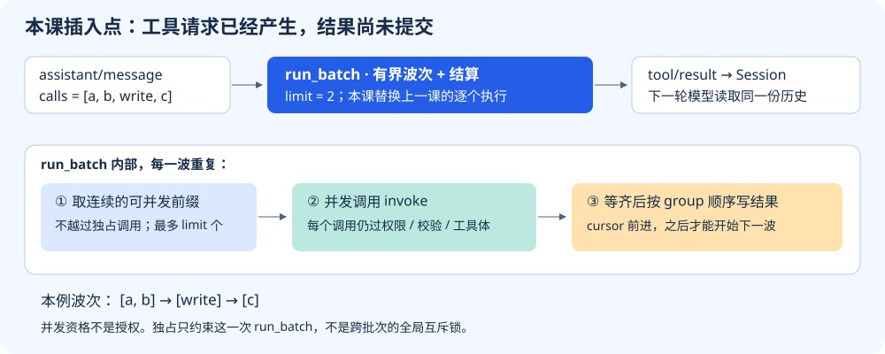
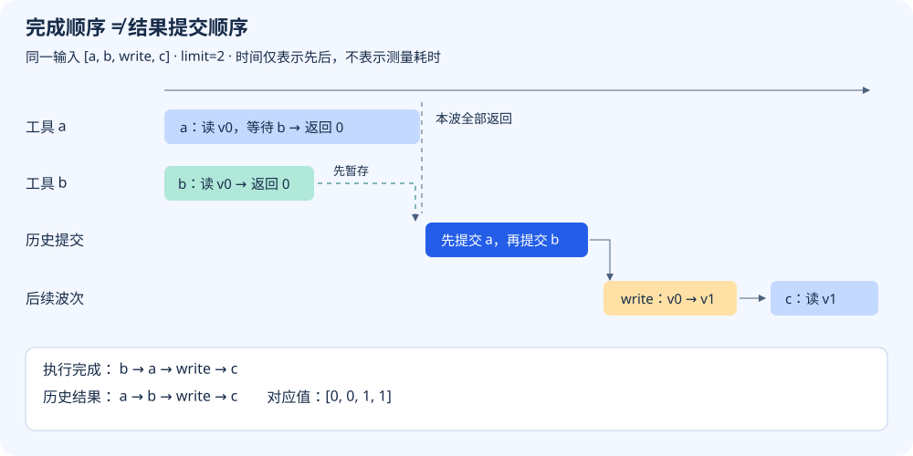
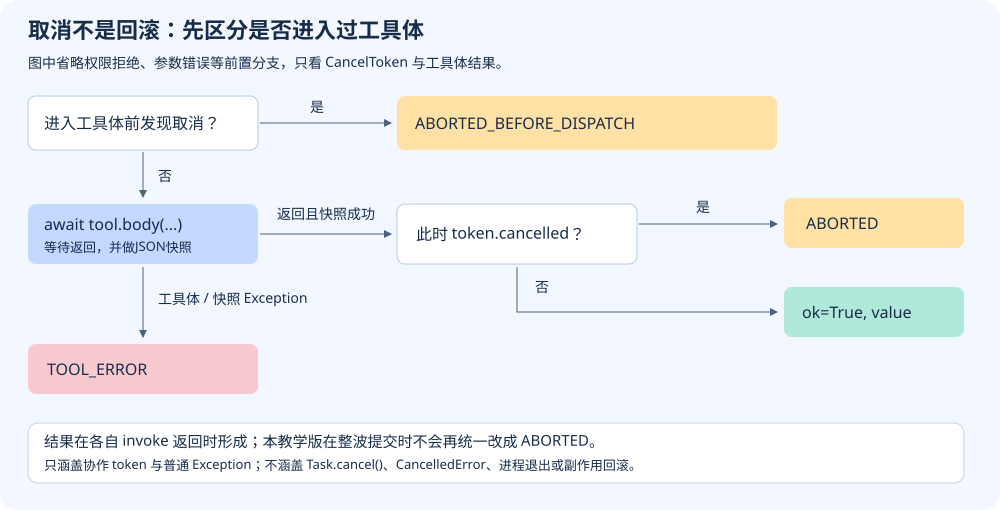

# S05 并发执行，按输入顺序结算

上一课已经把权限、审批和守卫放在工具体前面。现在模型一次提出四个调用：读 a、读 b、更新文档 write、再读 c。逐个执行当然容易理解，但 a 等待时，独立的 b 也被挡住了。

直接把四个调用全部并发同样不对：c 可能在 write 完成前读到旧版本。即使数据没有读错，“谁先完成就先写历史”也会让同一批结果的排列随执行时序变化。

本课要保住三件事：**允许重叠的调用可以重叠；独占调用不能被跨过；正常批次的结果按输入顺序提交。** 我们用同一批 `[a, b, write, c]` 走完整条路径，再检查取消和中断恢复留下什么证据。

## 1. 先看失败：完成顺序不适合直接当历史顺序

在项目根目录运行，无需模型、网络或密钥：

```sh
python3 walkthroughs/s05_settlement.py order
```

实验中的“文档”只是内存字典，初始版本为0。a、b读取版本；write把版本改成1；c应读到更新后的版本。脚本用 `asyncio.Event` 让 a 等到 b 完成，**不靠睡眠时长猜谁更快**。输出中的关键字段为：

```json
{
  "completion": ["b", "a", "write", "c"],
  "naive_history": ["b", "a", "write", "c"],
  "settled_history": ["a", "b", "write", "c"],
  "values": [0, 0, 1, 1],
  "peak": 2,
  "overlaps": []
}
```

完整输出另有 `events`，记录每个工具体的进入和离开。`completion`来自这些工具体；`settled_history`从本课Session中的真实 `tool/result` 事件提取。`naive_history`只是把完成列表原样当历史的**错误方案对照**，不是另一份实际模型会话。

b先完成没有错。错误是把“完成时刻”当作“提交位置”。`call_id`仍能配对结果，但稳定顺序让历史重放、展示和下一轮请求更容易检查。

## 2. 新机制插在哪里？



S03的 `Scope`、`Registry` 决定工具从哪里找到；S04的 `Policy` 决定能否执行。本课不替换这些机制，只把 `run_batch` 从单个调用改成有界波次。外层Agent循环仍然先记模型响应，再执行这一批调用：

[本课 code.py：循环中的插入点，第 215–218 行](../lessons/s05_settlement/code.py#L215-L218)

<!-- snippet: lessons/s05_settlement/code.py:215:218 -->
```python
        session.append("assistant/message", **response)
        calls = response.get("calls", [])
        if calls:
            await run_batch(calls, registry, scope, session, policy)
```

这里 `response` 是模型响应，`calls` 是其中的调用列表。先记 `assistant/message` 很重要：日志必须先知道模型提出了哪些ID，之后才有依据判断某个工具结果属于谁。

走读脚本把固定输入接到同一个运行时。`h` 指向本课的 `code.py`，不是上游生产运行时。调用对象只有三个字段：

[走读脚本：调用对象，第 10–11 行](../walkthroughs/s05_settlement.py#L10-L11)

<!-- snippet: walkthroughs/s05_settlement.py:10:11 -->
```python
def call(ident, name='read'):
    return {'id': ident, 'name': name, 'args': {'id': ident}}
```

例如 `call('a')` 得到 `{'id': 'a', 'name': 'read', 'args': {'id': 'a'}}`：外层id用于协议配对，name用于查找工具，args里的id只供这个实验区分a、b、c。它们在本例同名，但职责不同。

注册与执行如下。`scope`、`registry`、`session` 已在 `batch_case` 开头创建，`body` 是只操作内存版本的异步函数，下一节会追踪它的结果。

[走读脚本：同一批输入接入运行时，第 44–51 行](../walkthroughs/s05_settlement.py#L44-L51)

<!-- snippet: walkthroughs/s05_settlement.py:44:51 -->
```python
    registry.register(scope, h.Tool('read', body, parallel=lambda _: True))
    registry.register(scope, h.Tool('write', body,
                                    parallel=lambda _: unsafe_exclusive))
    calls = [call('a'), call('b'), call('write', 'write'), call('c')]
    session.append('assistant/message', calls=calls)
    results = await h.run_batch(calls, registry, scope, session, limit=limit)
    committed = [e['data']['call_id'] for e in session.events
                 if e['type'] == 'tool/result']
```

默认 `unsafe_exclusive=False`，所以read允许并发、write不允许。最后两行从事件中读出提交顺序，而不是把预期顺序直接打印出来。

## 3. 并发资格不是执行授权

怎样知道一个调用可以和别的调用重叠？先做保守分类：

[本课 code.py：并发分类，第 127–131 行](../lessons/s05_settlement/code.py#L127-L131)

<!-- snippet: lessons/s05_settlement/code.py:127:131 -->
```python
def parallel_safe(tool, args):
    try:
        return tool is not None and tool.validate(args) is True and tool.parallel(args) is True
    except Exception:
        return False
```

这几行有四层含义：工具必须存在；参数必须通过校验；工具的并发属性必须**精确返回True**；分类过程中抛异常就按独占处理。字符串 `"yes"` 和整数 `1` 都不满足 `is True`。

`Tool.parallel` 默认返回False，因此没有声明的工具不会被乐观并发。`validate`与`parallel`应是无副作用的检查函数，因为分组和真正执行时可能重复检查。

分类只回答“怎样安排”，不回答“是否允许”。每个 `invoke` 内部仍执行上一课的Policy与参数检查。拒绝路径会形成结果，但不会因此进入工具体。

## 4. 只收集连续前缀，不越过独占调用

先看 `run_batch` 的初始化：

[本课 code.py：批次入口约束，第 163–169 行](../lessons/s05_settlement/code.py#L163-L169)

<!-- snippet: lessons/s05_settlement/code.py:163:169 -->
```python
    if type(limit) is not int or limit < 1:
        raise ValueError("limit must be a positive integer")
    calls = snapshot(calls)
    if len({c["id"] for c in calls}) != len(calls):
        raise ValueError("duplicate call ids")
    policy, token = policy or Policy(), token or CancelToken()
    results, cursor = [], 0
```

`limit`必须是正整数；调用先做JSON快照，避免调用方随后修改参数；同批重复ID直接报错。`results`收集返回值，`cursor`指向尚未处理的第一个调用。下面这段代码位于同一函数里：

[本课 code.py：构造一波，第 193–200 行](../lessons/s05_settlement/code.py#L193-L200)

<!-- snippet: lessons/s05_settlement/code.py:193:200 -->
```python
    while cursor < len(calls):
        group = [calls[cursor]]
        first = registry.get(group[0]["name"], scope)
        if parallel_safe(first, group[0]["args"]):
            for call in calls[cursor + 1:cursor + limit]:
                if not parallel_safe(registry.get(call["name"], scope), call["args"]):
                    break
                group.append(call)
```

每一波先放入当前调用。如果它允许并发，就向后收集到最多 `limit` 个；遇到第一个不允许并发的调用，立即停止。**不能跳过write去捞后面的c。**

本例 `limit=2`，每次分组的结果是：

| cursor | 从哪里开始 | 本波group | 为什么在这里停 |
|---:|---|---|---|
| 0 | a | `[a, b]` | 达到并发上限2 |
| 2 | write | `[write]` | write默认独占 |
| 3 | c | `[c]` | 输入已结束 |

因此 `1 ≤ len(group) ≤ limit`，每一波都是尚未处理列表的连续前缀。独占调用只有自己，并且要等前一波结算完才开始。

## 5. 执行可以乱序，提交仍按原位置

分组之后就是本课的核心分界：

[本课 code.py：并发执行与有序提交，第 201–207 行](../lessons/s05_settlement/code.py#L201-L207)

<!-- snippet: lessons/s05_settlement/code.py:201:207 -->
```python
        # Preserve order; cooperative cancellation and caught errors leave each body awaited.
        outcomes = await asyncio.gather(*(invoke(c, registry.get(c["name"], scope)) for c in group))
        for call, outcome in zip(group, outcomes):
            session.append("tool/result", call_id=call["id"], **outcome)
            results.append({"call_id": call["id"], **outcome})
        cursor += len(group)
    return results
```

`invoke`返回一个outcome字典，例如 `{"ok": True, "value": 0}`。`asyncio.gather`让本波协程同时推进，但返回列表保留输入位置：即使b先返回，它仍占第二个位置。

本波全部返回后，`zip(group, outcomes)`按原调用顺序把ID与outcome重新组合，追加到Session。之后才推进cursor，允许下一波开始。这里展示的是协作取消与普通异常被转换为outcome的路径；外部强制取消协程并不由这一段自动解决。



回到刚才同一个输入。下表是对实际事件先后的解释，t0至t5是说明编号，不是测得的时间：

| 步骤 | 工具体与内存版本 | 结果暂存 | Session已提交的结果 |
|---|---|---|---|
| t0 | a、b进入，版本0 | 无 | 无 |
| t1 | b返回0，随后唤醒a | b→0 | 无 |
| t2 | a返回0 | outcomes中的value为`[0,0]` | 无 |
| t3 | 第一波结算 | 已清楚对应a、b | a→0，b→0 |
| t4 | write单独执行，版本改为1 | write→1 | 再追加write→1 |
| t5 | c读取版本1 | c→1 | 再追加c→1 |

为什么不能在 `body` 的结束回调里直接写 `tool/result`？因为那会把t1的b抢先提交，等价于输出中的naive_history。修复不是让a必须先完成，而是把“执行得到结果”和“把结果写入历史”分开。

### 故障对照：把write谎称为可并发会怎样？

先预测c读到哪个版本，再运行：

```sh
python3 walkthroughs/s05_settlement.py barrier --unsafe-exclusive
```

输入顺序没有改变，仍是 `[a,b,write,c]`。唯一改变是write的并发声明；波次变成 `[a,b] → [write,c]`。关键结果应为：

```json
{
  "settled_history": ["a", "b", "write", "c"],
  "values": [0, 0, 1, 0],
  "overlaps": [["c", "write"]]
}
```

历史看起来仍然有序，但c已经在write结束前读到了旧版本0。**有序提交不能修复错误的并发分类。** 去掉 `--unsafe-exclusive` 后，write回到单独波次，c返回1，overlaps为空。

## 6. 取消：保留已经发生的事实

S04已有取消检查。本课保留它们，并观察多个调用存在时的结算边界。下面是 `invoke` 在工具体前后的原代码；权限和参数检查位于这段之前：

[本课 code.py：工具体前后采样取消，第 185–191 行](../lessons/s05_settlement/code.py#L185-L191)

<!-- snippet: lessons/s05_settlement/code.py:185:191 -->
```python
        if token.cancelled:
            return {"ok": False, "code": "ABORTED_BEFORE_DISPATCH"}
        try:
            value = snapshot(await tool.body(snapshot(call["args"]), token))
            return {"ok": False, "code": "ABORTED"} if token.cancelled else {"ok": True, "value": value}
        except Exception as exc:
            return {"ok": False, "code": "TOOL_ERROR", "error": type(exc).__name__}
```

进入工具体前已取消，就返回 `ABORTED_BEFORE_DISPATCH`。已经进入的工具体则要继续到正常返回或普通Exception：正常返回且JSON快照成功后再次发现取消，结果为ABORTED；工具体或结果快照抛出普通Exception时走TOOL_ERROR。例如返回NaN并不满足JSON快照约束，不能当成正常成功值。



运行一个明确可检查的例子：

```sh
python3 walkthroughs/s05_settlement.py cancel
```

脚本中的工具先设置取消，再让出执行权，最后记下收尾标志：

[走读脚本：已开始的工作仍会收尾，第 83–87 行](../walkthroughs/s05_settlement.py#L83-L87)

<!-- snippet: walkthroughs/s05_settlement.py:83:87 -->
```python
    async def cancelling(args, token):
        token.cancelled = True
        await asyncio.sleep(0)
        cleanup.append('body finished')
        return 42
```

它以默认独占方式注册，输入为x、y。实际输出为：

```json
{
  "cleanup": ["body finished"],
  "codes": ["ABORTED", "ABORTED_BEFORE_DISPATCH"]
}
```

x确实进入并结束了工具体，所以cleanup有一项；x取消后，y在派发前被拦住。若改用 `cancel --pre-cancelled`，cleanup应为空，两个结果都为ABORTED_BEFORE_DISPATCH。

取消并不撤销副作用，也不能让永不返回的工具体自动结束。本课token不是 `Task.cancel()`，不涵盖 `CancelledError`、进程丢失等强制中断路径。此外，结果是在各自invoke返回时形成的：如果b已经成功返回，而a稍后才取消，b的成功结果不会在整波提交时被统一改成ABORTED。

## 7. 中断后缺结果，不等于可以重试

假设只恢复了一段有效日志：模型声明了两个调用，却没有匹配结果。我们至少要区分“没有尝试记录”和“已有尝试记录但结果未知”。

`pending_calls`扫描可见历史：assistant/message中的调用ID进入pending集合，匹配的tool/result将ID移出；重复调用ID、孤立或重复结果会报错。基于这个集合，恢复逻辑是：

[本课 code.py：保守补齐缺失结果，第 133–142 行](../lessons/s05_settlement/code.py#L133-L142)

<!-- snippet: lessons/s05_settlement/code.py:133:142 -->
```python
def recover_missing(session):
    """Record conservative facts; never retry tools."""
    pending = pending_calls(session.surface())
    started = {e["data"]["call_id"] for e in session.events if e["type"] == "tool/call"}
    result = {}
    for call_id in sorted(pending):
        code = "TOOL_OUTCOME_UNKNOWN" if call_id in started else "TOOL_NOT_STARTED"
        session.append("tool/result", call_id=call_id, ok=False, code=code)
        result[call_id] = code
    return result
```

变量 `started`存放的是出现过tool/call的ID。注意它的名字不能当作执行证明：本课在权限准备之前就记录tool/call，因此它只说明宿主进入了调用处理过程，不证明工具体已经运行。

| 有效日志里的证据 | 补充结果 | 它没有证明什么 |
|---|---|---|
| 模型声明调用，没有tool/call或结果 | TOOL_NOT_STARTED | 没有自动重试授权 |
| 有tool/call，没有结果 | TOOL_OUTCOME_UNKNOWN | 不能证明已成功，也不能证明无副作用 |
| 已有匹配结果 | 不补充 | 不会再结算一次 |

```sh
python3 walkthroughs/s05_settlement.py recovery
```

这个实验只构造内存日志，不真的执行或重复执行工具。模型顺序故意是 `[z-unseen,a-attempt]`，只给a-attempt添加tool/call。结果为：

```json
{
  "model_order": ["z-unseen", "a-attempt"],
  "recovery_order": ["a-attempt", "z-unseen"],
  "codes": {
    "a-attempt": "TOOL_OUTCOME_UNKNOWN",
    "z-unseen": "TOOL_NOT_STARTED"
  },
  "pending_after": []
}
```

这里必须和正常结算区别开：**教学恢复函数按ID排序补标记，不还原模型调用顺序。** 正常run_batch按输入顺序提交，不能把该承诺扩大到所有日志写入路径。

恢复入口也有前提：原执行已停止，只检查一个有效事件前缀。不要一边执行一边补缺失结果，否则真正结果稍后回来就会重复。本课没有把恢复自动接入Agent异常路径；函数不重试工具，对自己修复后的日志再次调用会返回空字典。

## 8. 动手验证：先预测，再看状态

每个命令都在内存里运行，并带断言；通过并不代表上游生产系统也运行过。

| 练习 | 命令 | 先预测的结果 | 如何判断理解正确 |
|---|---|---|---|
| 降低并发上限 | `python3 walkthroughs/s05_settlement.py barrier --limit 1` | peak=1，c仍返回1 | 降并发不应破坏独占边界 |
| 恢复安全声明 | `python3 walkthroughs/s05_settlement.py barrier` | overlaps=[]，values末项为1 | 与unsafe-exclusive对照，指出发生错误读取的位置 |
| 在派发前取消 | `python3 walkthroughs/s05_settlement.py cancel --pre-cancelled` | cleanup=[]，两个BEFORE_DISPATCH | 没有进入工具体，不只是错误文字不同 |
| 重复恢复 | 阅读recovery_case后，在末尾再调用recover_missing | 返回{} | pending已清空，不重复补结果 |

扩展练习：在走读脚本的read注册处，把 `parallel=lambda _: True` 改成返回字符串 `"yes"`，只运行 `barrier`。预期peak降为1，但values不变；用 `parallel_safe`解释原因。不要在这个修改下运行order：a等待b完成，而串行调度会让b无法开始，这是人为加入的依赖导致的等待环。走读入口在3秒后会报超时并说明这一原因，不会无限挂起；这个实验保护不是运行内核的强制取消或回滚保证。

完成后恢复原注册，再运行所有确定性检查：

```sh
python3 walkthroughs/s05_settlement.py all
python3 lessons/s05_settlement/code.py
```

第二条是本课累计系统的简短示例，输出model_order为c1、c2，values为42、6。它验证可独立启动；正文中的多边界实验负责解释为什么这样结算。

## 9. 回到DeepSeek源码：相同问题，不同规模

本课实现的是**有限波次**。上游采用持续补位的rolling pool：若输入为 `[慢a, 快b, c]`、limit=2，b完成后上游可以启动c，而教学版等a、b整波结束才启动c。上游还可以提交已完成的连续前缀，不要求整池一起结束。

另有三项适用范围：独占只在本次run_batch内成立，不是多个批次共享的全局锁；本波分类确定后不会因注册表改变重新分组；教学版取消在invoke返回时采样，而上游完成管线还有最终成功物化前的取消检查。这些差异不能用于推断两者性能相同。

按下列顺序核对源码，重点找分类、独占屏障、提交游标与取消收尾，而不是只搜索函数名：

- [并发池与独占屏障](https://github.com/deepseek-ai/deepseek-harness/blob/22ddee3792402c3e70ec5f86a63c3e3e895a2f60/packages/core/tools/src/batch.ts#L50-L279)：`packages/core/tools/src/batch.ts`，第50–279行。

- [并发属性必须显式为 true](https://github.com/deepseek-ai/deepseek-harness/blob/22ddee3792402c3e70ec5f86a63c3e3e895a2f60/packages/core/tools/tests/execution-mode.spec.ts#L26-L130)：`packages/core/tools/tests/execution-mode.spec.ts`，第26–130行。

- [成功结果最终物化前的取消检查](https://github.com/deepseek-ai/deepseek-harness/blob/22ddee3792402c3e70ec5f86a63c3e3e895a2f60/packages/core/tools/src/pipeline.ts#L336-L359)：`packages/core/tools/src/pipeline.ts`，第336–359行。

- [未开始与结果未知的恢复分类](https://github.com/deepseek-ai/deepseek-harness/blob/22ddee3792402c3e70ec5f86a63c3e3e895a2f60/packages/core/session/src/repair.ts#L15-L196)：`packages/core/session/src/repair.ts`，第15–196行。

恢复分类也依赖日志完整性：这里的“未开始”只在有效前缀内成立，不是从任意损坏日志证明没有执行。工具体能力、进程隔离和持久化故障属于其他边界。

## 下一课的问题

现在一批调用能留下配对、可检查的结果，但历史会越来越长。如果压缩时保留了工具结果，却删掉它对应的调用，下一轮模型会看到一段无从解释的协议。S06将继续使用本课的调用/结果关系，决定哪些压缩切点是安全的。
