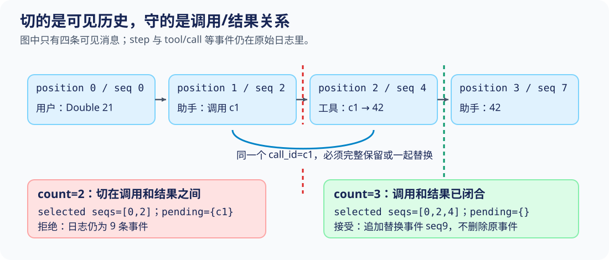
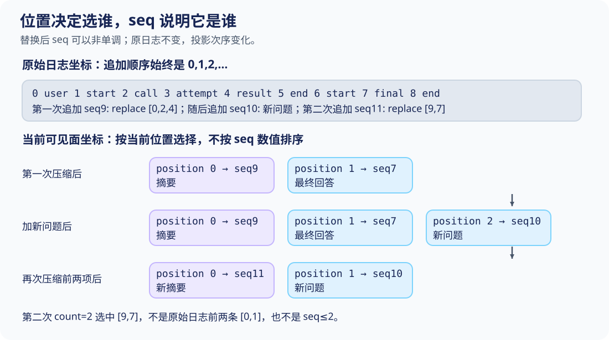

# S06 缩短上下文，但不切断工具协议

S05已经让每个工具调用获得可追踪的结算结果。会话继续进行十轮、百轮以后，下一次请求却仍可能带上许多旧消息。最直接的想法是“删掉最前面的几条”，但调用和结果并不总是恰好一起被删掉：如果摘要替换了调用c1，却把c1的结果留在后面，模型会收到一个没有来处的工具结果。

本课不讨论怎样写出好摘要，先解决更小、也更硬的问题：**什么范围允许被替换，替换之后怎样仍从同一份事件日志得到当前上下文。** 贯穿例子仍然是Double 21：用户请求、c1调用、结果42、最终回答。要分清两套坐标：当前可见面的position和原始事件的seq。

## 从一个被拒绝的切点开始

在项目根目录运行，无需网络、模型或密钥：

```sh
python3 walkthroughs/s06_compaction.py boundary --count 2
```

走读先加载本课教学快照，再运行真实的agent_loop和double工具，生成日志。固定模型提供调用与最终回答，工具结果则由工具体计算；不是把四条预期消息直接打印出来。

[走读脚本：建立同一段已完成对话，第 17–22 行](../walkthroughs/s06_compaction.py#L17-L22)

<!-- snippet: walkthroughs/s06_compaction.py:17:22 -->
```python
    registry.register(scope, h.Tool('double', double))
    calls = [{'id': 'c1', 'name': 'double', 'args': {'value': 21}}]
    model = h.ScriptedModel([{'calls': calls}, {'text': '42'}])
    await h.agent_loop(model, registry, scope, session)
    scope.close()
    return session
```

日志共9条事件，surface只选出四条：

| 当前position，从0开始 | 原事件seq | 可见内容 | 扫描到这里的pending |
|---:|---:|---|---|
| 0 | 0 | user：Double 21 | 空 |
| 1 | 2 | assistant：调用c1，double(21) | c1 |
| 2 | 4 | tool：c1成功，value=42 | 空 |
| 3 | 7 | assistant：42 | 空 |

seq1、3、5、6、8仍是日志中的步骤或调用尝试记录，只是不进入模型可见消息。表中的position不是seq的别名。

count=2表示取前两条**可见消息**，也就是seq0和seq2。实际输出包含：

```json
{
  "count": 2,
  "selected_seqs": [0, 2],
  "pending_at_cut": ["c1"],
  "accepted": false,
  "error": "compaction would cut a tool call/result pair",
  "log_before": 9,
  "log_after": 9
}
```

完整输出另有before、after位置表。拒绝发生在追加替换事件之前，因此日志没有“先破坏再撤销”。不要把错误修成直接删除前两条；正确修复是把范围推进到c1结果之后，也就是count=3。



## 先问有没有悬空调用，再谈摘要

S05已经使用pending_calls检查未结算调用。本课复用它，而不是发明另一套“差不多完整”的判断。

[本课 code.py：调用ID进入pending，第 75–84 行](../lessons/s06_compaction/code.py#L75-L84)

<!-- snippet: lessons/s06_compaction/code.py:75:84 -->
```python
def pending_calls(events):
    pending = set()
    seen = set()
    for event in events:
        if event["type"] == "assistant/message":
            for call in event["data"].get("calls", []):
                if call["id"] in seen:
                    raise ValueError("duplicate tool call id")
                seen.add(call["id"])
                pending.add(call["id"])
```

pending记录当前仍未获得结果的ID；seen记录这次扫描已经出现过的调用ID。遇到assistant/message时，每个调用进入两者。seen不会随结果被删除，因此同一段扫描中再次声明c1也会报错，不会被误认为一轮新的合法调用。

接着看结果路径：

[本课 code.py：匹配结果关闭调用，第 85–90 行](../lessons/s06_compaction/code.py#L85-L90)

<!-- snippet: lessons/s06_compaction/code.py:85:90 -->
```python
        elif event["type"] == "tool/result":
            call_id = event["data"]["call_id"]
            if call_id not in pending:
                raise ValueError("orphan or duplicate result")
            pending.remove(call_id)
    return pending
```

结果必须命中pending中的ID，然后移出。只有数量相等还不够：call c1配result c2，在这里会被当成孤立结果拒绝。重复结果也会失败，因为第一次结果已经把ID移出了pending。

对本例，扫描seq0不改变集合；扫描seq2后为{c1}；扫描seq4后回到空。切在第二步，未完成的协议单元跨过替换边界；切在第三步，整个单元已包含在摘要范围中。

这个函数不负责判断“42是否算对”。它也不因某个结果的ok=false就把它当作未完成：失败结果仍然是已知的结算事实，只要ID匹配，就能关闭调用。

## compact_prefix：先用位置选择，再记录身份

真正的入口只有十行，但每行都回答一个不同的问题：

[本课 code.py：前缀选择和替换事件，第 64–73 行](../lessons/s06_compaction/code.py#L64-L73)

<!-- snippet: lessons/s06_compaction/code.py:64:73 -->
```python
    def compact_prefix(self, count, summary):
        visible = self.surface()
        if type(count) is not int or not 0 < count <= len(visible):
            raise ValueError('invalid visible prefix')
        selected = visible[:count]
        if pending_calls(selected):
            raise ValueError('compaction would cut a tool call/result pair')
        if not isinstance(summary, str) or not summary.strip():
            raise ValueError('summary must be nonempty')
        return self.append('surface/replace', seqs=[e['seq'] for e in selected], summary=summary)
```

按执行次序读：

1. surface()先获得**此刻**的可见历史，而不是直接切原始_events。
2. count必须是正整数且不超过当前可见长度。这里用type(count) is int，布尔值True不会被当作1接受。
3. visible[:count]按当前顺序选前缀。起点始终在可见面的开头，左边没有被截掉的调用；pending检查负责证明右边没有未闭合调用跨出去。
4. 摘要至少得是非空白字符串。此处只验证类型与非空，不验证忠实程度或长度。
5. 追加surface/replace时，把选择结果转成seq列表。这份列表记录“替换的是哪些事件”，不是“以后再次运行时请重新取前count条”。

本课只提供前缀替换。若要支持任意中间片段，还必须检查左右两条边界；“片段内调用数等于结果数”不能代替外部上下文的完整性检查。

现在运行修复后的输入：

```sh
python3 walkthroughs/s06_compaction.py boundary --count 3
```

关键输出变为：

```json
{
  "selected_seqs": [0, 2, 4],
  "pending_at_cut": [],
  "accepted": true,
  "replacement_seq": 9,
  "log_before": 9,
  "log_after": 10
}
```

日志反而增加了一条，可见面却只剩摘要和原来的最终回答。**压缩缩短的是模型看到的投影，不是删除事实记录。** 这里说的日志只是本课内存列表，没有实际写磁盘，也没有事务持久化保证。

## surface如何把“追加”解释成“替换”

普通消息先进入投影。遇到surface/replace，才按它保存的seq身份撤下旧节点：

[本课 code.py：按日志顺序重建可见面，第 44–59 行](../lessons/s06_compaction/code.py#L44-L59)

<!-- snippet: lessons/s06_compaction/code.py:44:59 -->
```python
    def surface(self):
        """A projection, not mutation of the durable source events."""
        surface = []
        for event in self._events:
            kind, data = (event['type'], event['data'])
            if kind in {'user/message', 'assistant/message', 'tool/result'}:
                surface.append(event)
            elif kind == 'surface/replace':
                removed = set(data['seqs'])
                indexes = [i for i, item in enumerate(surface) if item['seq'] in removed]
                if not indexes:
                    raise ValueError('replacement no longer belongs to surface')
                first = indexes[0]
                surface = [item for item in surface if item['seq'] not in removed]
                surface.insert(first, {'seq': event['seq'], 'type': 'user/message', 'data': {'text': data['summary'], 'summary': True}})
        return snapshot(surface)
```

逐行对应本例：

- 回放前九个事件时，surface依次得到seq0、2、4、7。
- 读到seq9的替换记录，removed是{0,2,4}。indexes找到这些节点在**当前surface**中的位置[0,1,2]，first因此是0。
- 列表过滤掉这三个节点，再在原来第一个位置插入摘要。摘要的seq使用替换事件自己的seq9，类型投影成user/message，附带summary=True。
- 最终返回深复制的surface，避免调用方修改读出的列表后反向污染Session。

原seq0、2、4仍在_events里。下次surface()不是在上一次返回值上继续修补，而是从日志重新走一遍相同规则，所以重建Session也能得到同一结果。

这里的实现假设替换记录来自有效的compact_prefix调用，不是任意外部输入的通用日志验证器。例如它只在“没有任何待替换节点”时报错，没有为伪造的seq集合实现完整事务校验。不要直接手写surface/replace来绕开入口。

## 第二次压缩最容易暴露坐标混用

第一次替换以后，surface的seq顺序为[9,7]。9比7大，却出现在7前面，因为摘要占据旧前缀的位置，不是排到所有旧消息之后。

再追加一个新问题“Now explain why.”，它的日志seq是10。此时前两项是摘要seq9和最终回答seq7。运行：

```sh
python3 walkthroughs/s06_compaction.py repeat
```

实际执行部分如下：

[走读脚本：连续两次压缩与重建，第 51–61 行](../walkthroughs/s06_compaction.py#L51-L61)

<!-- snippet: walkthroughs/s06_compaction.py:51:61 -->
```python
async def repeat_case():
    session = await completed_session()
    original = session.events
    first = session.compact_prefix(3, 'Confirmed: double 21 is 42.')
    first_surface = positions(session)
    session.append('user/message', text='Now explain why.')
    before_second = positions(session)
    second = session.compact_prefix(2, 'The completed answer is 42.')
    replacements = [e for e in session.events if e['type'] == 'surface/replace']
    replay = h.Session(session.events)
    assert replay.messages() == session.messages()
```

第一次compact_prefix使用count=3，第二次使用count=2。两次都按当时的surface位置解释参数。第二次没有对原seq0、1再做一次替换。



从实际输出中提取状态：

| 时刻 | surface的seq顺序 | 新增日志事件 | 该事件的seqs字段 |
|---|---|---|---|
| 原始对话完成 | [0,2,4,7] | 无 | 无 |
| 压缩前三条 | [9,7] | seq9 surface/replace | [0,2,4] |
| 追加新问题 | [9,7,10] | seq10 user/message | 无 |
| 再压缩前两条 | [11,10] | seq11 surface/replace | [9,7] |

完整输出还确认original_prefix_unchanged=true、replay_equal=true、log_count=12。最终两条实际模型消息是摘要“The completed answer is 42.”和新问题“Now explain why.”。

如果程序把“前两条”错误翻译成seq≤1，会找回早已不在surface中的旧事件；如果把surface按seq重新排序，会把最终回答移到摘要前面。这两种改法都破坏了投影的语义。修复办法不是重编号旧事件，而是始终用position选范围，用seq保存身份。

## 结构合法，仍然可能把41当成事实

配对检查只保证协议没有被切断。它不能判断摘要是否忠实。下面保留同一份成功结果42，却故意给出错误摘要：

[走读脚本：错误摘要进入真实请求，第 75–83 行](../walkthroughs/s06_compaction.py#L75-L83)

<!-- snippet: walkthroughs/s06_compaction.py:75:83 -->
```python
async def semantic_case():
    session = await completed_session()
    confirmed = next(e['data']['value'] for e in session.events
                     if e['type'] == 'tool/result')
    wrong_summary = 'Confirmed: double 21 is 41.'
    session.compact_prefix(3, wrong_summary)
    model, scope = h.ScriptedModel([{'text': 'Received.'}]), h.Scope()
    await h.agent_loop(model, h.Registry(), scope, session)
    request = model.requests[0]
```

这里又运行了一次agent_loop，并读取ScriptedModel记录的实际请求，而不是只检查传入compact_prefix的字符串。

```sh
python3 walkthroughs/s06_compaction.py semantic
```

观察结果：

```json
{
  "confirmed_value_in_log": 42,
  "accepted_summary": "Confirmed: double 21 is 41.",
  "pending_after": []
}
```

完整request同时包含错误摘要41和剩下的助手回答42。程序接受了矛盾上下文；最后固定的“Received.”也不代表模型识别或修复了错误。

因此至少要分开检查三件事：

- 结构：所选调用/结果闭合，范围仍属于当前可见面。
- 语义：保留用户目标、输入21、已确认结果42、未完成事项和不确定性；拒绝把未知、被拒绝或未发生的动作改写成成功。
- 成本：摘要后的实际请求是否更短、是否满足目标模型限制。本课没有token计量，count=1甚至可能用更长文本替换一条短消息，结构合法并不等于值得压缩。

本课的摘要由调用者提供，没有模型summarizer、并发压缩锁或失败恢复事务，也不改变模型供应商内部的KV cache。

## 亲手预测三个边界

每条命令都只运行本地教学快照，输出从事件与请求中提取，并带有断言。先写下预测，再运行：

| 练习 | 命令 | 应观察到什么 | 要解释的原因 |
|---|---|---|---|
| 只替换用户请求 | python3 walkthroughs/s06_compaction.py boundary --count 1 | accepted=true，selected_seqs=[0] | 未切开工具单元，但不代表摘要足够忠实或更省空间 |
| 连最终回答一起替换 | python3 walkthroughs/s06_compaction.py boundary --count 4 | accepted=true，after只剩seq9 | 所有可见消息都在合法前缀内 |
| 检查第二次选择 | python3 walkthroughs/s06_compaction.py repeat | 第二份seqs=[9,7]，最终[11,10] | 选择依赖当前position，而非原seq排序 |
| 暴露错误摘要 | python3 walkthroughs/s06_compaction.py semantic | 日志42，摘要41，pending仍为空 | 配对验证不是事实验证 |

修改练习：在semantic_case中把41改成42，并同步把该字符串作为正确摘要。比较actual request即可；无需更改pending_calls或compact_prefix。这个修复应只改变摘要内容，不改变原工具结果、原事件数或切点是否合法。

```sh
python3 walkthroughs/s06_compaction.py all
```

[完整观测输出](../walkthroughs/expected/s06_compaction.json)可以与本机结果对照。入口采用asyncio.wait_for(..., 5)，给后来加入的协作等待设置5秒上限；本实验没有真实I/O等待。这个上限不等于操作系统强制终止，不能救回不让出执行权的死循环。

## 沿着两个问题读DeepSeek实现

[上游工具配对检查](https://github.com/deepseek-ai/deepseek-harness/blob/22ddee3792402c3e70ec5f86a63c3e3e895a2f60/packages/compaction/compaction/src/tool-pairing.ts#L29-L83)把当前surface中的调用/结果变化折叠成平衡状态，并按替换generation处理缓存。读它时注意：这里展示的是计数与位置缓存；本课pending_calls则显式用ID集合查重复和孤立结果，不应把两段代码说成逐行相同。

[CompactionEngine范围契约](https://github.com/deepseek-ai/deepseek-harness/blob/22ddee3792402c3e70ec5f86a63c3e3e895a2f60/packages/compaction/compaction/src/index.ts#L119-L195)明确区分surface位置顺序与数值seq顺序，并要求范围两端平衡。上游接口还涉及自动触发、手动压缩、取消与事务状态。本课只选择“安全前缀替换”这一条可观察路径，没有复现全部调度与持久化机制。

下一课换一个减少无关上下文的入口：旧历史可以压缩，但大量技能正文是否应该一开始就全部进入请求？S07把“看见目录”“拿到正文”和“模型实际看见正文”分开验证。
