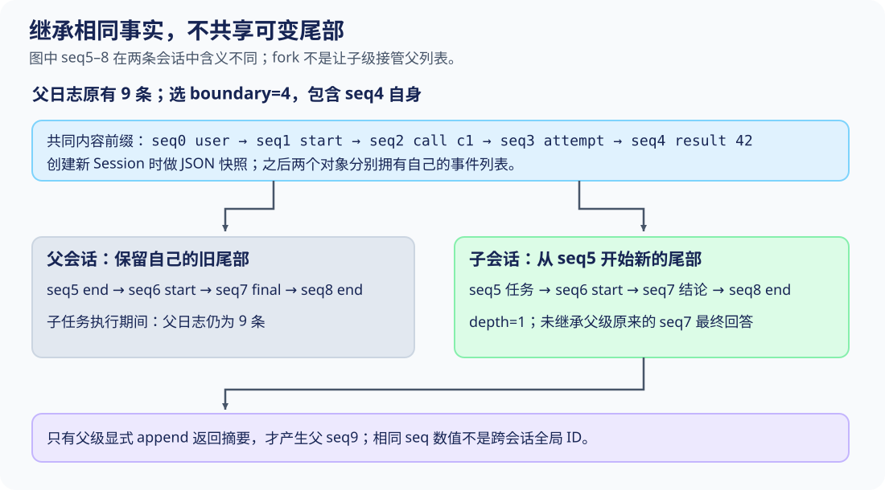
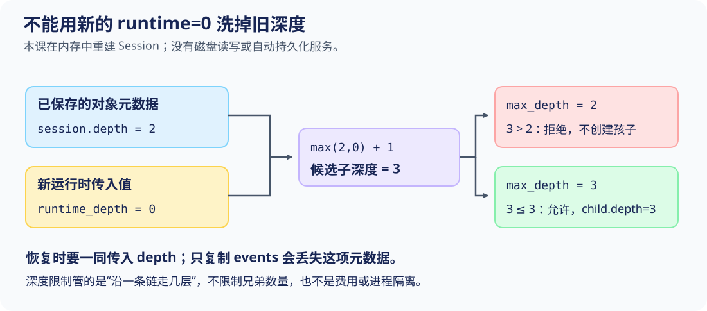

# S08 继承事实前缀，各自拥有会话尾部

S07已经能明确记录模型何时看到技能正文。现在任务要拆开：父级已经确认double(21)=42，想把“解释这个结果”交给一个子会话。孩子需要知道已确认的事实，却不该把自己的每一步自动追加到父级历史里。

只写child=parent并没有创建孩子；只复制messages又丢掉了原始事件边界、替换记录和调用尝试等信息。另一个更隐蔽的问题是深度：如果本来位于第2层的会话重建后被当成第0层，它又能继续委派，原有递归上限就失去了意义。

本课把两件事分开解决：**按原事件seq截取一个配对完整的前缀，再构造独立Session；候选子深度取max(已保存深度, 运行时深度)+1。** 全部实验在同一个Python进程内完成，不创建线程、远程任务或真实模型服务。

## 先看“新名字”为什么不是“新会话”

在项目根目录运行：

```sh
python3 walkthroughs/s08_subagents.py alias
```

错误实验只做了一次普通赋值：

[走读脚本：故意让父子引用同一对象，第 136–143 行](../walkthroughs/s08_subagents.py#L136-L143)

<!-- snippet: walkthroughs/s08_subagents.py:136:143 -->
```python
async def alias_case():
    parent = await completed_session()
    before = len(parent.events)
    child = parent  # Deliberately wrong: another name for the same Session.
    child.append('user/message', text='Child-only work leaked into parent')
    report = {'same_object': child is parent, 'parent_before_count': before,
              'parent_after_count': len(parent.events),
              'parent_tail': parent.messages()[-1]['text']}
```

输出为：

```json
{
  "same_object": true,
  "parent_before_count": 9,
  "parent_after_count": 10,
  "parent_tail": "Child-only work leaked into parent"
}
```

消息仍然经过append，事件seq也连续，所以只检查日志格式不会发现问题。坏的是所有权：两个变量指向同一个Session，“子任务写入”实际上就是“父任务写入”。修复需要新对象和独立的内部数据，不能只给变量换个名字。

后面的实验每次都重新建立干净会话，不会沿用这个已污染的父级。

## 选哪一段事实给孩子？

父级仍执行同一段Double 21对话，得到9个原始事件和四条可见消息。为了只交付已确认事实，不交付父级后来的最终回答，本课选择工具结果所在的seq4作为边界。



这里的boundary是**原始事件seq，包含边界事件自身**。它不是S06的可见前缀条数，也不是surface中的position。对本例：

| 想指的对象 | 数值 | 含义 |
|---|---:|---|
| 结果在surface中的position | 2 | 第三条可见消息 |
| 压缩到结果之后所需count | 3 | 取前三条可见消息 |
| fork继承到结果所用boundary | 4 | 复制原事件seq0至4，共5条 |

把position=2错误传给fork，会切在assistant声明c1之后，而不是切在工具结果之后。这个坐标混用会在下一节被拒绝。

走读从真实日志寻找工具结果的seq，不硬编码“第五条”：

[走读脚本：从事件身份找到边界，第 24–25 行](../walkthroughs/s08_subagents.py#L24-L25)

<!-- snippet: walkthroughs/s08_subagents.py:24:25 -->
```python
def result_boundary(session):
    return next(e['seq'] for e in session.events if e['type'] == 'tool/result')
```

这仍有场景前提：本实验只有一个工具结果，所以next选中唯一目标。多轮、多工具的宿主应根据具体任务与call_id选择边界，而不是永远取第一个结果。

## fork的检查顺序决定了哪些孩子能出生

先看入口和深度计算：

[本课 code.py：合法边界与候选深度，第 78–86 行](../lessons/s08_subagents/code.py#L78-L86)

<!-- snippet: lessons/s08_subagents/code.py:78:86 -->
```python
    def fork(self, boundary, runtime_depth=0, max_depth=2):
        """Conservative lesson: only balanced prefixes; upstream can repair open tails."""
        if type(boundary) is not int or not 0 <= boundary < len(self._events):
            raise ValueError('unknown fork boundary')
        if any((type(x) is not int or x < 0 for x in [runtime_depth, max_depth])):
            raise ValueError('invalid delegation depth')
        depth = max(self.depth, runtime_depth) + 1
        if depth > max_depth:
            raise ValueError('delegation depth exceeded')
```

boundary必须是已存在的整数seq。由于Session要求事件从0连续编号，这里可以把seq直接用于列表切片；无法从这个实现推导“任意稀疏ID也能这么切”。runtime_depth和max_depth也必须是非负整数，True或负数不能充数。

depth是准备赋给孩子的新深度，超过max_depth就拒绝。在这之前还没有创建子Session。稍后再追踪为什么必须取max，先看事实前缀的检查：

[本课 code.py：复制前缀前检查工具配对，第 87–90 行](../lessons/s08_subagents/code.py#L87-L90)

<!-- snippet: lessons/s08_subagents/code.py:87:90 -->
```python
        prefix = self._events[:boundary + 1]
        if pending_calls(Session(prefix).surface()):
            raise ValueError('lesson fork requires a balanced prefix')
        return Session(prefix, depth=depth)
```

prefix取原始事件直到boundary，含边界本身；临时Session(prefix).surface()把这段前缀派生成可见消息，保留S06可能发生过的替换语义；pending_calls检查是否仍有悬空调用。只有这一检查通过，才构造携带新depth的子Session。

运行两个相邻语义边界的对照：

```sh
python3 walkthroughs/s08_subagents.py boundary
```

关键输出：

```json
{
  "visible_seqs": [0, 2, 4, 7],
  "cuts": [
    {"boundary_seq": 2, "accepted": false, "error": "lesson fork requires a balanced prefix"},
    {"boundary_seq": 4, "accepted": true, "inherited_count": 5}
  ]
}
```

seq2之后，子历史中会有c1但没有对应结果；父级后面虽然已经得到42，选定前缀并不会神奇地包含未来事件。修复是选择seq4，或在真正的调用尚未结束时等待父级完成，而不是在孩子里假造一个成功结果。

本课的“平衡”特指工具调用/结果，不是全部生命周期都闭合。seq4前缀仍包含seq1的step/start，尚未包含父级seq5的step/end。教学fork没有修复步骤或回合尾部；不要把这一个检查扩大成生产会话完整性验证。

## 独立性来自构造时的快照，不只是列表切片

prefix切片只创建了一个新列表，里面的嵌套事件字典仍可能是旧引用。真正切断这条共享关系的是新Session的构造函数：

[本课 code.py：写入和读出的数据都不借出内部引用，第 30–40 行](../lessons/s08_subagents/code.py#L30-L40)

<!-- snippet: lessons/s08_subagents/code.py:30:40 -->
```python
    def __init__(self, events=None, depth=0):
        if type(depth) is not int or depth < 0:
            raise ValueError('depth must be a non-negative integer')
        self.depth = depth
        self._events = snapshot(events or [])
        if any((event['seq'] != i for i, event in enumerate(self._events))):
            raise ValueError('event sequence must be contiguous from zero')

    @property
    def events(self):
        return snapshot(self._events)
```

snapshot通过JSON序列化/反序列化复制嵌套数据：

[本课 code.py：独立JSON数据的边界，第 11–13 行](../lessons/s08_subagents/code.py#L11-L13)

<!-- snippet: lessons/s08_subagents/code.py:11:13 -->
```python
def snapshot(value: Any) -> Any:
    """Create a JSON-normalized copy; reject non-finite or unsupported values."""
    return json.loads(json.dumps(value, allow_nan=False))
```

因此它复制的是可表示的事件数据，不是Python协程、锁、工具函数或模型连接。NaN与JSON编码器不支持的对象会失败；tuple等值则可能被规范化成list，并非任意Python对象的无损复制。它不会把活动资源“克隆”成独立执行环境。

events属性也返回快照。外部代码取出child.events并修改字典，改变的只是读出副本，不能反向改写child，更不能改写parent。

```sh
python3 walkthroughs/s08_subagents.py snapshot
```

实验先修改读出副本，再分别追加父级、子级自己的后续消息：

[走读脚本：外部修改与两条独立尾部，第 104–108 行](../walkthroughs/s08_subagents.py#L104-L108)

<!-- snippet: walkthroughs/s08_subagents.py:104:108 -->
```python
    child = parent.fork(result_boundary(parent))
    borrowed = child.events
    borrowed[0]['data']['text'] = 'changed outside'
    parent.append('user/message', text='Parent-only follow-up')
    child.append('user/message', text='Child-only follow-up')
```

实际输出为：

```json
{
  "parent_first": "Double 21",
  "child_first": "Double 21",
  "parent_tail": "Parent-only follow-up",
  "child_tail": "Child-only follow-up",
  "parent_original_prefix_unchanged": true
}
```

这证明的是内存状态独立，不是安全沙箱。父子仍在同一进程内；如果给子级的工具开放相同外部资源，它仍可能影响那些资源。Session.fork也不接收Registry或Policy，不会自动复制、缩减或隔离工具权限。

## 同一个42，怎样交付、执行、再返回？

运行完整委派走读：

```sh
python3 walkthroughs/s08_subagents.py delegation
```

先建立子会话并显式写入任务：

[走读脚本：前缀、任务与子级执行范围，第 28–40 行](../walkthroughs/s08_subagents.py#L28-L40)

<!-- snippet: walkthroughs/s08_subagents.py:28:40 -->
```python
async def delegation_case():
    parent = await completed_session()
    original = parent.events
    boundary = result_boundary(parent)
    child = parent.fork(boundary)
    inherited_count = len(child.events)
    task = 'Explain the verified result; use no tools; return one sentence.'
    child.append('user/message', text=task)
    value = next(m['value'] for m in child.messages() if m['role'] == 'tool')
    model = h.ScriptedModel([{'text': f'Doubling 21 gives the verified result {value}.'}])
    child_scope = h.Scope()
    await h.agent_loop(model, h.Registry(), child_scope, child,
                       policy=h.Policy(decide=lambda _: 'deny'))
```

这段交接有四个可检查部分：

- 任务：解释已确认结果，来自子级新追加的user/message。
- 事实：从父级seq0至4继承，其中工具结果是42；value从子级实际消息中取出。
- 权限：本次使用新的空Registry，并明确传入deny策略，不因继承事实而自动获得工具能力。
- 返回格式：一句话，便于父级决定是否纳入自己的历史。

子级Scope是独立创建的，且没有注册工具。这不是fork函数替你配置的默认安全环境，而是这个调用者明确作出的配置。固定模型的回答由脚本给定，所以实验不评价解释质量，只观察正确事实是否在输入里、输出是否按约定回到父级。

实际child_request按顺序包含用户Double 21、assistant的c1调用、tool的value=42，以及子任务文本。父级原来的seq7最终回答没有继承进来，因为它超过boundary=4。

子级结束后，父级仍不会自动出现它的结论。返回必须显式写入：

[走读脚本：父级决定怎样纳入结果，第 41–44 行](../walkthroughs/s08_subagents.py#L41-L44)

<!-- snippet: walkthroughs/s08_subagents.py:41:44 -->
```python
    unchanged = parent.events == original
    summary = child.messages()[-1]['text']
    parent.append('assistant/message', text=summary, source='child-summary',
                  child_depth=child.depth)
```

unchanged在父级append之前检查原日志；summary取子级最后一条文本。source='child-summary'和child_depth是本次返回的来源说明，不是全局会话ID，也不是通用身份认证。这里用assistant/message记录父级采纳的结论，没有把整段子日志拼回去。

关键观测为：

```json
{
  "fork_boundary_seq": 4,
  "inherited_count": 5,
  "child_depth": 1,
  "parent_unchanged_before_return": true,
  "parent_has_child_task": false,
  "parent_before_count": 9,
  "parent_after_count": 10,
  "child_count": 9
}
```

孩子新增自己的任务、步骤和回答；父级只新增一个seq9返回事件。父子都可能有seq7，但两条会话中的seq7内容不同：事件序号只在各自Session里有意义，不能拿它当跨会话全局身份。

若实际子任务可能产生外部副作用，返回契约还应区分“已做”“未做”“结果未知”。本例没有外部动作，所以一句解释足够；不能把这个返回格式泛化成任何任务都只需一句“完成了”。

## 深度为何要取max，而不能相信新的runtime=0

设一个会话已经处于第2层，重建时运行时选项又采用默认值0。如果直接用runtime+1，就会把下一代错误记成1，造成“重启一次，又有两层预算”。



本课fork已展示真实计算：max(self.depth, runtime_depth)+1。self.depth给出不能被新的运行时低值抹掉的下界；runtime_depth允许宿主把当前环境视为更深，但不能把它变浅。

走读在内存中模拟重建，并把两项分别传递：

[走读脚本：重建时保留深度元数据，第 77–85 行](../walkthroughs/s08_subagents.py#L77-L85)

<!-- snippet: walkthroughs/s08_subagents.py:77:85 -->
```python
async def depth_case():
    original = await completed_session()
    saved_events, saved_depth = original.events, 2
    restored = h.Session(saved_events, depth=saved_depth)
    boundary = result_boundary(restored)
    rows = []
    for runtime, maximum in [(0, 2), (0, 3), (4, 5)]:
        try:
            child = restored.fork(boundary, runtime_depth=runtime, max_depth=maximum)
```

这里saved_depth=2是本次故障测试的输入，不是从磁盘读出来的事实。代码没有落盘，也没有加载生产存储；它验证“调用者把已保存的深度传回来时，新的runtime=0不能降低它”。

```sh
python3 walkthroughs/s08_subagents.py depth
```

逐项结果如下：

| 重建对象的depth | runtime_depth | 候选子深度 | max_depth | 实际结果 |
|---:|---:|---:|---:|---|
| 2 | 0 | 3 | 2 | delegation depth exceeded |
| 2 | 0 | 3 | 3 | 接受，child.depth=3 |
| 2 | 4 | 5 | 5 | 接受，child.depth=5 |

### 一个必须看见的缺口：events里没有depth

同一命令还会输出：

```json
{
  "without_depth_metadata": 1,
  "event_log_contains_depth": false
}
```

这是因为深度存放在Session对象的depth属性，不在事件列表里。走读故意只用Session(saved_events)重建一次，它采用默认depth=0，再fork就得到1。max并不能凭空恢复丢失的元数据。

修复是把事件和可信的会话元数据一起保存、一起重建，像前面的Session(saved_events, depth=saved_depth)。不要靠修改数字“给孩子加层数”。本课没有存储服务，也没有防止同一进程中的代码直接改depth属性；这里讨论的是正确宿主调用下的记账规则，不是抵抗恶意代码的安全边界。

## 深度预算不限制兄弟数量

另一个常见误判是“max_depth=1，所以最多只能创建一个孩子”。深度只限制沿一条链能走几层，同一个父级可以创建多个同层孩子。

```sh
python3 walkthroughs/s08_subagents.py siblings
```

实际得到三个孩子，sibling_depths=[1,1,1]，children_created=3；它们再尝试产生第2层时都收到delegation depth exceeded。没有任何一项显示全局任务数或费用被限制为1。

生产宿主还可能需要总孩子数量、活跃并发数、总请求数、时间、token或费用预算。这些预算不等价，也不在当前fork接口里。不要从“最大深度2”推导“任务成本有界且足够小”。

## 做一份可以反驳错误实现的检查单

每个命令都带断言。先说出要看哪个状态，再执行：

| 要排除的错误 | 命令 | 应观察到的证据 |
|---|---|---|
| 赋值就算新会话 | python3 walkthroughs/s08_subagents.py alias | same_object=true，子追加直接增加父事件 |
| 把surface位置当fork边界 | python3 walkthroughs/s08_subagents.py boundary | boundary2拒绝，boundary4继承5事件 |
| 读出字典仍能修改内部状态 | python3 walkthroughs/s08_subagents.py snapshot | 父子第一条都保持Double 21，两条尾部各自不同 |
| 低runtime重置旧深度 | python3 walkthroughs/s08_subagents.py depth | saved2/runtime0/max2拒绝；丢失元数据的对照却得到1 |
| 孩子输出自动进入父历史 | python3 walkthroughs/s08_subagents.py delegation | 返回前父不变，显式返回后只加1条 |
| 深度等于孩子总数 | python3 walkthroughs/s08_subagents.py siblings | 三个depth1孩子都能创建，却不能继续创建depth2 |

修改练习：在delegation_case中把选择边界改为父日志最后一条事件的seq，再运行delegation。你需要同步调整“继承5条”和孩子事件总数的预测：此时继承9条，孩子收到父级最终回答42，追加任务和一轮无工具回复后共有13条；父级在返回前仍应不变。不要为了让旧断言通过而删除子级事件，应根据新的边界重新推导数量。

恢复原脚本后运行：

```sh
python3 walkthroughs/s08_subagents.py all
```

[完整实际输出](../walkthroughs/expected/s08_subagents.json)包含child_request和父级返回事件。异步入口有5秒协作等待上限，防止练习加入永不被唤醒的asyncio等待后一直挂起；它不处理同步死循环，也不是进程级超时隔离。

## 对照上游：哪些约定相同，哪些更严格？

[buildForkSeed的事件前缀构造](https://github.com/deepseek-ai/deepseek-harness/blob/22ddee3792402c3e70ec5f86a63c3e3e895a2f60/packages/core/session/src/fork.ts#L21-L30)在inclusive前缀后追加session/end-seed，并调用openTurnClosers处理开放尾部。教学版没有这些合成收尾事件，而是对开放工具调用直接拒绝；不能把教学输出的事件数量套到上游。

[delegationDepthOf的深度下界](https://github.com/deepseek-ai/deepseek-harness/blob/22ddee3792402c3e70ec5f86a63c3e3e895a2f60/packages/subagent/subagent/src/depth.ts#L28-L39)读取会话header与运行时options的较大值。该函数返回当前深度，不是子深度；接着读[resolveChildDepth的子级预算检查](https://github.com/deepseek-ai/deepseek-harness/blob/22ddee3792402c3e70ec5f86a63c3e3e895a2f60/packages/subagent/subagent/src/child-agent.ts#L49-L58)：它再加1，检查结果仍是安全整数，并在超过maxDepth时抛错。本课把这两步放进同一个Session.fork，但Python整数校验与上游JavaScript安全整数限制也不是完全相同的数值边界。

到这里，事实来源、知识输入、执行许可、结算顺序、可见面和子级状态都可以分别检查。接下来的综合实验要回答更实际的问题：把这些机制同时串起来，能否在一次运行里证明“结果确实执行、压缩未切断协议、子级没有污染父级、资源也被正确撤销”，而不是只看最后一句42？
