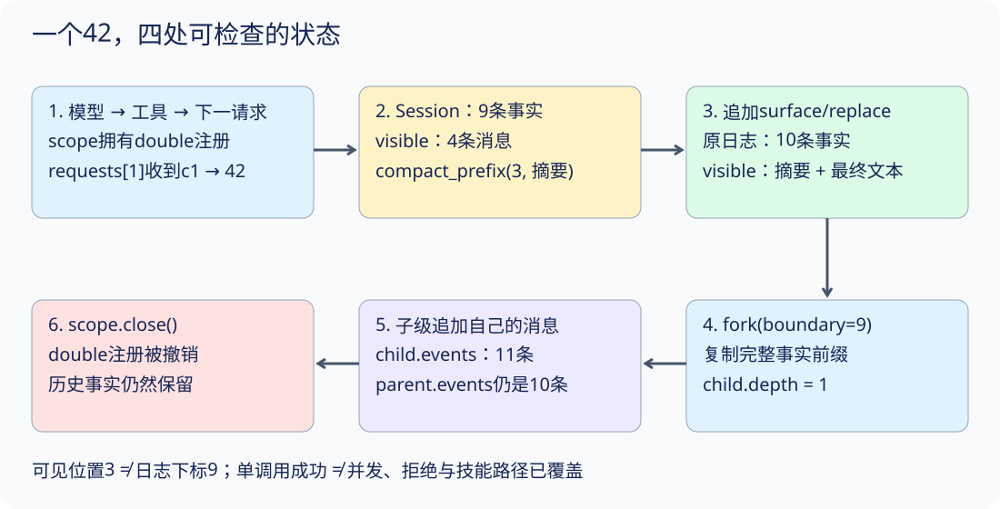

# 把八个机制装成一个可解释系统

你已经有循环、事件、作用域、守卫、结算、压缩、技能与子会话。综合实验不再加入新抽象，而是检查它们组合后是否仍然守住自己的边界。

## 一次完整旅程

```sh
python3 -m examples.scenarios
```

实验注册 double，记录用户请求，让假模型发出调用，执行后把结果交给下一次模型请求，得到最终回答。随后把完整调用单元压成摘要，从平衡前缀创建子级，最后卸载工具。

应看到：value=42；日志从 9 条变为 10 条但可见消息只有 2 条；子级深度为 1；子级写入后父级不变；卸载后工具不可见。value从第二次实际假模型请求里的工具结果读取，不是由最终文本推断。

## 组合图：连接数据，而不是只把类放在一起



箭头表示本例调用顺序，不是同时运行的多个服务。Session保存事实；model.requests保存实际请求快照；Registry保存工具注册。这三份状态各有自己的读取和修改入口。把其中一个状态检查正确，不能替代检查另外两个。

本例使用八课最终运行时，但不是八机制的全覆盖实验：这里只有一个工具，不展示乱序完成；没有显式Policy参数，走默认允许路径；也没有加载技能正文。并发、拒绝、技能可见性必须分别运行S05、S04、S07走读，不能从综合实验的成功推断它们已经被触发。

## 第一步：让注册、调用、观察真正接起来

[综合实验实现，第 12–20 行](../examples/scenarios.py#L12-L20)

<!-- snippet: examples/scenarios.py:12:20 -->
```python
async def capstone():
    scope, registry, session = Scope(), Registry(), Session()
    registry.register(scope, Tool('double', double, validate=lambda a: type(a.get('value')) is int,
                                  parallel=lambda _: True))
    session.append('user/message', text='Double 21')
    script = [{'calls': [call()]}, {'text': 'The result is 42.'}]
    model = ScriptedModel(script)
    await agent_loop(model, registry, scope, session)
    observed = model.requests[1][-1]['value']
```

registry.register把double归属给scope。validate只接受真正的int，因而Python中属于int子类的bool也不通过；parallel允许调度器把它视为并发候选，但单调用不产生并发效果。模型脚本先提出c1，再返回固定文本。agent_loop负责执行和回灌。

关键检查点是observed读取第二次实际请求的末项value，而不是读取最终固定文本。这个固定单调用实验可以这样按位置取值；扩展到多工具时，应按call_id查找，避免把另一个结果误当c1。

## 第二步：压缩用可见位置，fork用原日志位置

[综合实验实现，第 21–25 行](../examples/scenarios.py#L21-L25)

<!-- snippet: examples/scenarios.py:21:25 -->
```python
    before = len(session.events)
    session.compact_prefix(3, 'User asked to double 21; result 42 was confirmed.')
    child = session.fork(len(session.events) - 1)
    child.append('user/message', text='Explain the result to a new reader')
    scope.close()
```

压缩前visible有user、assistant调用声明、tool结果、assistant最终文本，共4项。compact_prefix(3, ...)选择前三项，恰好包含c1的完整调用对；它追加一个surface/replace事件，不删除旧事件。可见面变为摘要和最终文本两项，原事件由9增至10。

fork接收的不是可见消息数，而是原日志的零基下标。本例len(session.events)-1为9，复制包含替换事件在内的全部事实。孩子随后追加自己的用户消息；父亲仍是10条。scope.close撤销double注册，但不会删除历史中的调用或结果：过去发生的事实不应随插件卸载一起消失。

| 检查点 | 父日志长度 | 父可见消息 | 另一个必须检查的状态 |
|---|---:|---:|---|
| 循环完成 | 9 | 4 | 第二请求已收到c1→42 |
| 压缩完成 | 10 | 2 | 替换只影响投影，原事实还在 |
| fork后子级追加 | 10 | 2 | 子日志11条，depth=1 |
| scope关闭 | 10 | 2 | registry.get返回None |

表格由本例确定性路径解释，不是耗时测量，也不是磁盘持久化记录。

## 第三步：把每个结论变成独立验收

[综合实验实现，第 26–30 行](../examples/scenarios.py#L26-L30)

<!-- snippet: examples/scenarios.py:26:30 -->
```python
    return {'value': observed, 'durable_events_before_compaction': before,
            'durable_events_after_compaction': len(session.events),
            'visible_messages': len(session.messages()), 'child_depth': child.depth,
            'parent_unchanged_after_child_write': len(session.events) + 1 == len(child.events),
            'tool_removed_after_dispose': registry.get('double', scope) is None}
```

字段名durable_events沿用示例输出，但它指的是本例保留的内存事件，不能据此认为已经写入磁盘。parent_unchanged_after_child_write只比较长度，单独看它不足以排除“等长改写”；S08的独立性实验还会比较完整父数据，并尝试修改嵌套对象。这是组合验收与单机制边界测试的分工。

运行命令的完整输出应为：

```json
{
  "value": 42,
  "durable_events_before_compaction": 9,
  "durable_events_after_compaction": 10,
  "visible_messages": 2,
  "child_depth": 1,
  "parent_unchanged_after_child_write": true,
  "tool_removed_after_dispose": true
}
```

## 练习：只改一个边界，先预测哪一步失败

1. 在examples/scenarios.py中临时把compact_prefix的3改为2，再运行 `python3 -m examples.scenarios`。应得到 `ValueError: compaction would cut a tool call/result pair`：选中的前缀有调用声明却没有结果。不是摘要文字不够好，而是切点已经破坏协议。恢复3后，输出应再次与上表一致。
2. 临时省略scope.close，运行同一命令。value仍是42，但tool_removed_after_dispose变为false。这证明答案正确不能代替资源释放验收。恢复关闭语句。
3. 运行 `python3 walkthroughs/s07_skills.py visibility --skip-injection`，观察load计数正常却所有实际请求均无正文标记。再去掉该选项运行，第三次请求才包含标记。解释为什么本章未调用技能，所以无法替这项检查作证。
4. 恢复所有修改后运行 `python3 -m unittest discover -s tests -v` 与 `make check`。综合测试逐字段对比上述输出；片段检查还会确认正文与当前实现没有漂移。

第1项异常会发生在scope.close之前，因此这个示例的直线成功路径不会在异常时执行关闭。对象只存在于这次短命进程内；不要将这个写法直接复制到长驻宿主。扩展作业可用try/finally包围注册后的工作，并在故障后断言注册确已撤销，保留原ValueError而不是吞掉异常。这是需要另外实现和测试的异常清理路径，不是本例已有保证。

## 成功不是只有最终答案对了

如果最终打印了 42，但被拒绝的 body 执行过，系统仍然失败。如果压缩缩短了字符串，却留下孤立结果，也失败。如果子级最终答案正确，却通过深度重置无限委派，也失败。

可以把验收写成四组问题：

- 事实可解释吗：每次模型请求能否从已记录事件推导？
- 执行有边界吗：拒绝、无审批通道与执行前检查异常是否阻止 body？工具体开始后才发生的异常，是否保留为失败而非假装回滚？
- 资源有终点吗：协作取消与普通异常路径中的已启动工作是否收尾，注册是否撤销？
- 历史可延续吗：压缩和 fork 是否保留协议完整与预算？

## 如何把教学机制放回真实项目

DeepSeek Harness 不把所有东西放进一个巨大的核心类。公开 Agent 接口与默认 agent-loop 分离；tools、llm、Session、scope 分工；提供方通过服务与事件 seam 组合。连默认循环也属于可替换插件，而不是不可触碰的特权核心。

Profile 是具名组装，bundle 提供配置层。固定版本中的配置按有序 bundle、profile patch、home patch、CLI overlay 等层组合；局部替换改变能力提供方，不必给循环增加每个新场景的分支。sdk-minimal 是显式最小配置树，并不等同于全部产品功能的缩略版。

[Profile 与分层组合](https://github.com/deepseek-ai/deepseek-harness/blob/22ddee3792402c3e70ec5f86a63c3e3e895a2f60/docs/architecture.zh.md#L13-L37)

不要把本课的 Python Registry 当成真实 profile loader。真实配置支持依赖、作用域、HMR 与插件管理，风险和行为都更多。第一次研究真实配置，优先只读查看固定版本文档与配置树；真正运行前应准备一次性环境、最小权限和完整依赖审查。

## 一个适合贡献的小项目

在本教程而非生产 Harness 上加入“审计计数插件”：记录成功、拒绝、取消与未知结果的数量。限制是：插件不能改变工具返回值，不能把未知计为成功，卸载后不再接收事件。

建议先写失败测试，再实现。最终交付包含：三个例子、至少六个边界断言、明确的卸载行为，以及你选择的上游 seam 链接。这个作业检验的是能否围绕接口扩展，而不是能否改一个全局计数器。

## 适用范围

课程检查覆盖标准库教学逻辑、每课独立运行、正文片段与代码的一致性、源码文件哈希、静态网页链接和实际走读输出。[验证报告](../QA_REPORT.md)列出具体范围。

未验证的层次：官方 dsh 的依赖安装与运行、真实模型输出质量、外部工具权限、系统沙箱、真实会话存储迁移、GPU 性能和生产可靠性。这些检查不依赖模型下载，也不能替代上游集成测试。
